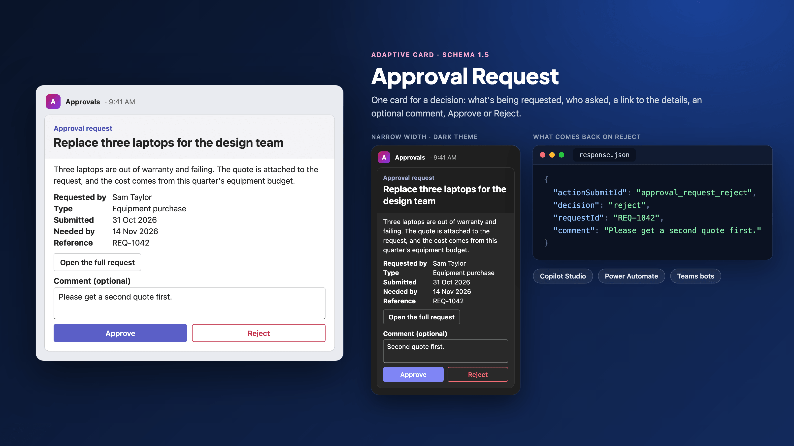

# Approval Request

## Summary

A card that asks one person to approve or reject one request. It shows what's being requested and why, who asked, the request type, when it was submitted, when a decision is needed, a reference and a link to the full request. The approver can add an optional comment, then selects **Approve** or **Reject**.

When the approver selects a button, the host gets back the decision, the request reference and the comment in one response, so a flow, a topic or an agent can branch on it straight away.

It only asks. It doesn't route the request, check who answered, chase the approver, record the decision or update itself afterwards: that is the job of the flow, topic or agent that sends it. [Before you rely on a response](#before-you-rely-on-a-response) lists what that code must check.



## Choose the right tool

Power Automate already has an approvals feature, so check whether you need a card at all.

| You need | Use |
|---|---|
| A standard approval with an audit trail: one or more approvers, everyone or first to respond, sequential approvals, history kept for you | Power Automate's **Start and wait for an approval** action. Approvals are saved in Dataverse and need a Dataverse database, which the default environment creates for you (Get started with approvals) |
| Stages that mix people and AI reviews, with conditions between them, run from Copilot Studio | Multistage approvals in agent flows, which are in preview (Multistage and AI approvals in agent flows) |
| Your own layout, an approval inside a Copilot Studio conversation, or a bot or agent that owns the decision and stores it itself | This card |

## What's in the folder

| File | What it's for | Where it goes |
|---|---|---|
| [`card.json`](./card.json) | The card template, schema version 1.5, with eight `${...}` bindings | Pasted into the host, with the bindings replaced |
| [`data.json`](./data.json) | Made-up sample values for every binding | The Adaptive Cards Designer's sample data pane, or your own code as a model |

## The bindings

Each `${...}` in `card.json` is one value. Replace it, keeping the quotation marks around it. Some appear more than once: `${requestId}` four times, `${title}` and `${requestUrl}` twice.

In Teams, every one of these is rendered as Markdown: "Markdown is supported in Adaptive Card Textblock field, and Fact.Title and Fact.Value" (Format text in cards). A `*` or `_` in a requester's name or in `details` changes the formatting, so escape or strip Markdown characters from text that people typed.

| Binding | What goes there | Sample |
|---|---|---|
| `${title}` | One line naming what is being requested | Replace three laptops for the design team |
| `${details}` | Why it's needed and anything the approver must know | Three laptops are out of warranty… |
| `${requesterName}` | The person who asked | Sam Taylor |
| `${requestType}` | The kind of request | Equipment purchase |
| `${submittedOn}` | When it was submitted, already formatted as text | 31 Oct 2026 |
| `${neededBy}` | When a decision is needed, already formatted as text | 14 Nov 2026 |
| `${requestId}` | Your reference for the request. It appears on the card **and** comes back with the decision, so you know which request was answered | REQ-1042 |
| `${requestUrl}` | A full `https://` link to the request, with its documents. Build it in the sending system from the request's ID, on a host you own. Never copy a link supplied by the requester: it goes into the button as is, and the approver trusts it because the card came from your flow or bot | https://example.com/requests/REQ-1042 |

To show different details, add, remove or rename rows in the `FactSet`. Leave out a row rather than sending it empty. If there is nothing to link to, delete the `ActionSet` that holds **Open the full request** and shorten `fallbackText`, which is the line a client shows when it can't render the card ("Text shown when the client doesn't support the version specified", schema 1.5).

## What comes back

When the approver selects Approve or Reject, the inputs are merged with that button's `data` (Action.Submit "gathers input fields, merges with optional data field, and sends an event to the client", Adaptive Cards schema 1.5):

| Field | Approve | Reject |
|---|---|---|
| `actionSubmitId` | `approval_request_approve` | `approval_request_reject` |
| `decision` | `approve` | `reject` |
| `requestId` | the request's reference | the request's reference |
| `comment` | what the approver typed, or empty | what the approver typed, or empty |

Each button also has an `id` (`approve`, `reject`). **Open the full request** opens the link and sends nothing back. It sits in the body, not with the other two buttons, so the card keeps two primary actions: Teams suggests "1-3 primary actions" (Designing Adaptive Cards for your app).

## Use it

### Power Automate: send the request to an approver in Teams

1. Add the Microsoft Teams action **Post adaptive card and wait for a response**. The older per-channel and per-user versions are marked deprecated.
2. Set **Post as** and **Post in** to the approver's chat or a channel.
3. Paste `card.json` into **Message**. Replace each `${...}` with dynamic content from earlier steps, keeping the quotation marks. `${requestId}` appears three times: once in the facts and once in each button.
4. Escape any value that can contain a double quotation mark, a backslash, a tab or a line break, which is likely for `details`. Inserted as is, such a value breaks the JSON, and improperly formatted JSON is one of the most common problems Microsoft lists for a failed card (Create your first adaptive card). Learn doesn't give an escaping expression (as of 31 October 2026); this one works for a value `X`:

   ```text
   replace(replace(replace(replace(replace(X, '\', '\\'), '"', '\"'), decodeUriComponent('%0D'), ''), decodeUriComponent('%0A'), '\n'), decodeUriComponent('%09'), '\t')
   ```

5. Fill in **Update message** and set **Should update card** to Yes, for example "Thanks, your decision has been recorded." Without them the card "resets and then appears exactly the same" after a response, and Microsoft recommends update messages "to update others and prevent consumers from attempting to submit the card more than once".
6. Plan for no answer. A run can last 30 days, and "after 30 days, any pending steps time out" (Power Automate limits). Add a branch after the action whose **Run after** setting covers the action timing out, to remind someone or escalate: Run after decides what happens "if an action fails, times out, is skipped, or is successful" (Error handling). A shorter timeout on the action itself isn't documented on the pages cited here (as of 31 October 2026); check the action's settings in your designer.
7. After the action, branch on the response. The comment comes back as dynamic content named after its input, `comment`, and "the user ID of the person submitting the card" is available too. The connector reference lists the action's outputs only as dynamic, and Learn doesn't document how the selected button appears in them (as of 31 October 2026). Run the flow once, open the run history and read the action's outputs before you build the condition: look for the `data` fields (`decision`, `requestId`, `actionSubmitId`) and for the button's `id` (`approve` or `reject`).

The flow waits until someone responds, and a card can be submitted only once: "any further submissions are ignored". In a channel, anyone in it can answer, and the first answer decides.

### Copilot Studio: ask the user in a topic

1. In a topic, add an **Ask with Adaptive Card** node, open **Edit adaptive card**, and paste `card.json` into the card payload editor.
2. In the node's properties, switch to **Formula**. Copilot Studio converts the card to a Power Fx formula. Replace each `"${...}"` string, quotation marks included, with a variable, for example `Topic.RequestTitle`. The card is then a Power Fx record rather than text, so a quotation mark in a variable doesn't break it. Once you edit the formula you can't go back to JSON, so keep `card.json`.
3. Check the output variables. Copilot Studio creates them from the card's inputs, so `comment` appears. Learn doesn't say whether the buttons' `data` fields are added too (as of 31 October 2026); if `decision`, `requestId` or `actionSubmitId` are missing, add them with **Edit Schema**.
4. Add a condition on `decision`, after the checks in [Before you rely on a response](#before-you-rely-on-a-response). Earlier cards stay clickable, and a retry resends the card, so "users might select Submit on an earlier card".

The card goes to whoever is chatting with the agent, so this suits an agent that an approver talks to, such as "show me what's waiting for my approval". To send a request to someone else, call a flow from the topic and follow the Power Automate steps.

The card works in the Teams and Microsoft Copilot channel and on a website, because it uses `Action.Submit`. In Microsoft Copilot, "Adaptive Cards with Action.Execute" aren't supported, and Microsoft Copilot "might remove embedded URLs", so check that **Open the full request** still opens there.

### A Teams bot or custom engine agent

Build new bots with the Microsoft 365 Agents SDK, "the evolution of the Azure Bot Framework SDK", or the Teams SDK (formerly the Teams AI library). The Bot Framework SDK is archived and "support tickets for the Bot Framework SDK will no longer be serviced as of December 31, 2025".

Expand the template with your data, then send the result. In JavaScript, with the `adaptivecards-templating` package:

```js
import * as ACData from "adaptivecards-templating";

const card = new ACData.Template(template).expand({ $root: request });
```

The .NET package is `AdaptiveCards.Templating`. An `Action.Submit` comes back as an activity "with the Value property containing an object with all of the input data on it" (Adaptive Cards: Getting Started): the fields in [What comes back](#what-comes-back).

For a card sent only by a Teams bot, Teams recommends `Action.Execute` ("Prefer Action.Execute for new projects"). To switch:

1. Change both buttons' `type` to `Action.Execute` and give each a `verb` (`approve`, `reject`). Leave the `data` as it is.
2. Handle the `adaptiveCard/action` invoke. The Teams SDK surfaces it as a `card.action` activity with the inputs and the button's `data`, and your handler returns the card to show next.
3. To show the decision to everyone in the conversation, edit the original message. Microsoft's approval example uses a bot message edit, which also refreshes the card for the users listed in its `refresh.userIds`, up to 60 (Up to date cards; Universal Actions).

Keep `Action.Submit` if the same card is also used in Copilot Studio: Bot Framework Web Chat "doesn't support Action.Execute", and neither does Microsoft Copilot.

### Try it without a host

Open the [Adaptive Cards Designer](https://adaptivecards.microsoft.com/designer), paste `card.json` into the card payload editor and `data.json` into the sample data editor, and switch to preview mode.

## Before you rely on a response

The response comes from the user's client, so treat every field as input, not proof.

1. **The card.** `actionSubmitId` is `approval_request_approve` or `approval_request_reject`. Copilot Studio asks you to include an identifier "in each submit action's data payload and validate it when processing the response".
2. **The request.** `requestId` matches a request that is still waiting for a decision. Ignore a second answer to the same request, whether it comes from a stale card, a retry or a second person in a channel.
3. **The person.** The responder is someone allowed to decide this request. Compare the responder's user ID (Power Automate), the signed-in user (Copilot Studio) or the activity's sender (a bot) with the approver you assigned, not with a name on the card.
4. **The link and the comment.** `requestUrl` must come from your system, never from the requester (see [The bindings](#the-bindings)). Treat the comment as untrusted text. `maxLength` is a "hint of maximum length… (may be ignored by some clients)", so cut it to 500 characters before you store it, and escape it before you put it into another card or a message.
5. **The record.** Store the decision, the responder, the time and the comment in your own system. The card keeps no history; the approvals action does.

## Test plan

Run these in your tenant before relying on the card. None of them have been run for this release.

| # | Test | Pass when |
|---|---|---|
| 1 | Post the card from a flow to a chat, in Teams desktop and Teams mobile, in light and dark themes, and in a meeting side panel | Nothing is cut off at narrow widths. The Teams cards reference asks for full-width cards to be tested in narrow form factors such as mobile and meeting side panels; this card isn't full width, but the same check applies |
| 2 | Approve with no comment | The flow gets `decision` = `approve`, the right `requestId`, an empty `comment` and the responder's ID |
| 3 | Reject with a comment containing `"`, `\` and a line break, and a `details` value with the same | The card posts and the comment comes back intact |
| 4 | Select a button again after the first response | The card shows the update message; nothing reaches the flow |
| 5 | Let the request time out | The timeout branch runs |
| 6 | In Copilot Studio, answer the card, then select a button on an earlier copy | The topic ignores the stale response |
| 7 | In the Teams and Microsoft Copilot channel and on a website | The card renders, Open the full request opens the link, and both buttons submit |
| 8 | With a screen reader | The comment box is announced with its label |

## Prerequisites

- **Power Automate:** the Workflows app installed in Teams and allowed in the Teams admin center. The Flow bot poster isn't available in GCC, GCCH or DoD tenants; post as a user there.
- **Copilot Studio:** an agent with a topic you can add an Ask with Adaptive Card node to.
- **A bot or agent:** the Microsoft 365 Agents SDK or the Teams SDK, and `adaptivecards-templating` 2.3.1 or `AdaptiveCards.Templating` to fill in the bindings.

## Limitations

- **Schema version 1.5.** Copilot Studio supports 1.6 and earlier, but says Teams and the live chat widget are "limited to version 1.5" (21 October 2026). The Teams cards reference now says Teams supports 1.6 (13 October 2026). The card stays at 1.5 until the two pages agree, and it needs 1.5: the title's `"style": "heading"` is a 1.5 property. The `$schema` value is the one Copilot Studio's sample uses; the older `adaptivecards.io` address redirects to it.
- **Button colours.** `positive` and `destructive` make Approve and Reject stand out where the host supports action styles, as in the preview image. "Positive or destructive action styling is not supported in Adaptive Cards on the Teams platform", so in Teams both buttons look the same; the button text carries the meaning.
- **The comment is always optional.** Inputs are validated when the user selects any `Action.Submit` that sends them (Input Validation), so marking the comment `isRequired` for Reject would make it required for Approve too, unless Approve stops sending the comment at all.
- **One approver, one decision.** The card has no stages, delegation, reassignment or reminders. Use the approvals action or multistage approvals for those.
- **English labels, one language.** "Approval request", the fact titles, "Comment (optional)", "Approve" and "Reject" are hard-coded in English, and the root `lang` is `en`. For another audience, translate them in `card.json`; there is no per-user translation in a card.
- **Dates are plain text.** `submittedOn` and `neededBy` are shown as you format them, in your time zone. Adaptive Cards can instead localise a time to the viewer's device: "Adaptive Cards offers DATE() and TIME() formatting functions to automatically localize the time on the target device", written as `{{DATE(2026-11-14T17:00:00Z, SHORT)}}` with an ISO 8601 UTC timestamp (Text features). That page shows it in a `TextBlock`; whether it works inside a `Fact.value` in Teams isn't documented, so test it before relying on it.
- **Not for webhooks or Outlook.** Office 365 Connectors in Teams, "including connector-based Incoming Webhooks, were retired in May 2026"; post from a flow instead, which is what the Workflows app runs. Outlook actionable messages use a different action model (Outlook "used Action.Http"), so the card's buttons don't work in an email.
- **Size.** 2.6 KB filled in with the sample data. Power Automate's Teams actions fail above "approximately 28 KB", so long `details` text is the thing to watch.
- **Templating is labelled preview.** The Adaptive Cards templating overview still describes the template language and SDKs as a preview, and those pages are dated May 2020. The card uses plain property bindings only, so it works the same once you replace them by hand.
- **Not tested in a tenant.** The card was checked against the Adaptive Cards 1.5 JSON schema with the sample data filled in, and rendered with the Adaptive Cards JavaScript renderer 3.0.6 for the preview image. It hasn't been posted from a flow, a Copilot Studio agent or a bot; run the [test plan](#test-plan) first.

## Sources

Microsoft Learn, with each page's `ms.date` when it was read on 31 October 2026:

- [Ask questions with Adaptive Cards (Copilot Studio)](https://learn.microsoft.com/en-us/microsoft-copilot-studio/authoring-ask-with-adaptive-card), 21 Oct 2026
- [Use Adaptive Cards in Copilot Studio](https://learn.microsoft.com/en-us/microsoft-copilot-studio/adaptive-cards-overview), 21 Oct 2026
- [Connect and configure an agent for Teams and Microsoft Copilot](https://learn.microsoft.com/en-us/microsoft-copilot-studio/publication-add-bot-to-microsoft-teams), 29 Oct 2026
- [Multistage and AI approvals in agent flows (preview)](https://learn.microsoft.com/en-us/microsoft-copilot-studio/flows-advanced-approvals), 4 Sep 2025
- [Get started with Power Automate approvals](https://learn.microsoft.com/en-us/power-automate/get-started-approvals), 29 Apr 2026
- [Overview of adaptive cards for Microsoft Teams (Power Automate)](https://learn.microsoft.com/en-us/power-automate/overview-adaptive-cards), 19 Aug 2026
- [Create your first adaptive card (Power Automate)](https://learn.microsoft.com/en-us/power-automate/create-adaptive-cards), 19 Aug 2026
- [Limits of automated, scheduled, and instant flows](https://learn.microsoft.com/en-us/power-automate/limits-and-config), 17 Jul 2026
- [Error handling (Power Automate coding guidelines)](https://learn.microsoft.com/en-us/power-automate/guidance/coding-guidelines/error-handling), 10 Jul 2025
- [Microsoft Teams connector reference](https://learn.microsoft.com/en-us/connectors/teams/), `ms.date` 1 Mar 2024; the generated reference's own updated date is 2 Oct 2026
- [Create and explore card types in Teams (Cards reference)](https://learn.microsoft.com/en-us/microsoftteams/platform/task-modules-and-cards/cards/cards-reference), 13 Oct 2026
- [Adaptive Card actions in Teams SDK](https://learn.microsoft.com/en-us/microsoftteams/platform/task-modules-and-cards/cards/cards-actions), 10 Jun 2026
- [Designing Adaptive Cards for your app](https://learn.microsoft.com/en-us/microsoftteams/platform/task-modules-and-cards/cards/design-effective-cards), 5 Aug 2026
- [Format text in cards](https://learn.microsoft.com/en-us/microsoftteams/platform/task-modules-and-cards/cards/cards-format), 22 Oct 2026
- [Webhooks and connectors in Teams](https://learn.microsoft.com/en-us/microsoftteams/platform/webhooks-and-connectors/what-are-webhooks-and-connectors), 23 Jan 2025
- [Universal Actions for Adaptive Cards overview](https://learn.microsoft.com/en-us/microsoftteams/platform/task-modules-and-cards/cards/universal-actions-for-adaptive-cards/overview), 30 Sep 2026
- [Use Universal Actions for Adaptive Cards](https://learn.microsoft.com/en-us/microsoftteams/platform/task-modules-and-cards/cards/universal-actions-for-adaptive-cards/work-with-universal-actions-for-adaptive-cards), 20 Dec 2022
- [Up to date cards](https://learn.microsoft.com/en-us/microsoftteams/platform/task-modules-and-cards/cards/universal-actions-for-adaptive-cards/up-to-date-views), 16 Sep 2026
- [Teams bots overview](https://learn.microsoft.com/en-us/microsoftteams/platform/bots/bot-features), 7 May 2025
- [Azure Bot Framework SDK to Microsoft 365 Agents SDK migration guidance](https://learn.microsoft.com/en-us/microsoft-365/agents-sdk/bf-migration-guidance), 28 Apr 2026
- [What's new in the Bot Framework SDK](https://learn.microsoft.com/en-us/azure/bot-service/what-is-new?view=azure-bot-service-4.0), 9 Oct 2024
- [Adaptive Cards Templating overview](https://learn.microsoft.com/en-us/adaptive-cards/templating/), 18 May 2020
- [Adaptive Cards Template Language](https://learn.microsoft.com/en-us/adaptive-cards/templating/language), 18 May 2020
- [Adaptive Card Templating SDKs](https://learn.microsoft.com/en-us/adaptive-cards/templating/sdk), 15 May 2020
- [Input Validation (Adaptive Cards)](https://learn.microsoft.com/en-us/adaptive-cards/authoring-cards/input-validation), 24 Jul 2020
- [Adaptive Cards: Getting Started](https://learn.microsoft.com/en-us/adaptive-cards/authoring-cards/getting-started), 9 Nov 2017
- [Adaptive Cards: Text features](https://learn.microsoft.com/en-us/adaptive-cards/authoring-cards/text-features), 18 Jun 2020

The Teams card pages above now carry a notice that they are "considered legacy" and point to the [Adaptive Cards documentation hub](https://adaptivecards.microsoft.com/) for the current schema reference, Designer and samples. The hub is a web app without dated pages, so the card's facts are cited from Learn and from the published schema below.

Other sources, read on 31 October 2026:

- [Adaptive Cards 1.5 JSON schema](https://github.com/microsoft/AdaptiveCards/blob/main/schemas/1.5.0/adaptive-card.json), last changed 15 Nov 2021: the `Action.Submit`, `Input.Text` and `ActionStyle` definitions
- [adaptivecards](https://www.npmjs.com/package/adaptivecards) 3.0.6 (7 Apr 2026) and [adaptivecards-templating](https://www.npmjs.com/package/adaptivecards-templating) 2.3.1 (20 Sep 2022), used to render the preview and check the bindings

## Contributors

| Name | Links |
| --- | --- |
| Arindam Choudhury | [GitHub](https://github.com/ari20089) · [LinkedIn](https://www.linkedin.com/in/arindam-choudhury/) |

## Version history

| Version | Date | Comments |
| --- | --- | --- |
| 1.0 | October 2026 | Initial release |

## Help

Adaptive Cards here are community samples without support. Search [existing issues](https://github.com/ari20089/agents-in-practice/issues) or [open a new one](https://github.com/ari20089/agents-in-practice/issues/new/choose). For Microsoft product questions use Microsoft Learn or your Microsoft support channel.

## Disclaimer

**THIS CODE IS PROVIDED _AS IS_ WITHOUT WARRANTY OF ANY KIND, EITHER EXPRESS OR IMPLIED, INCLUDING ANY IMPLIED WARRANTIES OF FITNESS FOR A PARTICULAR PURPOSE, MERCHANTABILITY, OR NON-INFRINGEMENT.**
