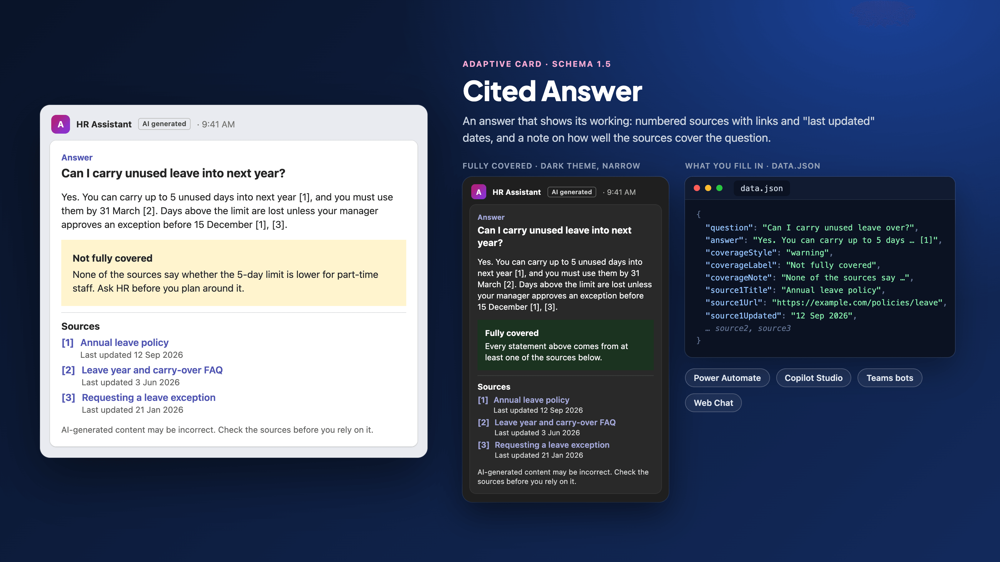

# Cited Answer

## Summary

A card that shows an answer together with the evidence behind it:

- the question;
- the answer, with numbered markers such as `[1]`;
- a coverage note: green "Fully covered" when the sources back every statement, amber "Not fully covered" with what's missing when they don't;
- three sources, each a title that links to it, with a "last updated" line;
- a closing line saying the content is AI-generated.

It only displays. It has no buttons and sends nothing back. It doesn't find the sources, decide the coverage or check the links: the flow, topic or bot that fills it in does that, and [Before you send it](#before-you-send-it) lists what to check.



## Choose the right tool

Teams and Copilot Studio can show citations themselves, so check whether you need a card.

| Where the answer comes from | Use |
|---|---|
| A Copilot Studio generative answer, shown as it is | The built-in citations. In Teams, "Copilot Studio agents automatically return citation links only for answers without customizations" (Add a generative answers node) |
| A Copilot Studio generative answer that you customize | This card is one documented way to do it: store the answer in a variable and show it "on an Adaptive Card" in a Message or Question node (Add a generative answers node). The steps are in [Copilot Studio](#copilot-studio-show-an-answer-in-a-topic). If you'd rather keep Teams' own citation pop-ups, Learn shows how to send the citations with a `SendActivity` node and `citationEntities` instead (Connect and configure an agent for Teams and Microsoft Copilot) |
| A Teams bot or agent you build | Teams' own citations, for most answers: in-text markers "in the [#] format", each opening a pop-up with the title, link and abstract, up to 20 per message, each able to carry the source's sensitivity label, with the "AI Generated" label next to the agent's name (AI content labels). Use this card when the dates and the coverage note must be visible without hovering |
| A Power Automate flow, or a website chat built on Bot Framework Web Chat | This card |

## What's in the folder

| File | What it's for | Where it goes |
|---|---|---|
| [`card.json`](./card.json) | The card template, schema version 1.5, with 14 `${...}` bindings | Pasted into the host, with the bindings replaced |
| [`data.json`](./data.json) | Made-up sample values for every binding: a leave policy question with three intranet sources | The Adaptive Cards Designer's sample data pane, or your own code as a model |

## The bindings

Each `${...}` in `card.json` is one value. Replace it, keeping the quotation marks around it. `${question}` and `${answer}` each appear twice: once in the body and once in `fallbackText`, which a client shows when it can't render the card ("Text shown when the client doesn't support the version specified", schema 1.5).

| Binding | What goes there | Sample |
|---|---|---|
| `${question}` | The question, as the user asked it | Can I carry unused leave into next year? |
| `${answer}` | The answer, with a `[1]`, `[2]` or `[3]` after each statement that comes from that source; write two together as `[1], [3]`, since `[1][3]` is also Markdown's reference-link syntax. Use `\n\n` between paragraphs | Yes. You can carry up to 5 unused days… |
| `${coverageStyle}` | `good` when every statement has a source, `warning` when part of the question isn't covered | `warning` |
| `${coverageLabel}` | The heading of the note. Always match it to the style: "Fully covered" with `good`, "Not fully covered" with `warning` | Not fully covered |
| `${coverageNote}` | What the sources do and don't cover, and what the reader should do about the gap | None of the sources say whether the 5-day limit is lower for part-time staff… |
| `${source1Title}` | The source's title, shown as a link | Annual leave policy |
| `${source1Url}` | A full `https://` link to the source | https://example.com/policies/annual-leave |
| `${source1Updated}` | When the source was last changed, already formatted as text | 12 Sep 2026 |

`source2…` and `source3…` work the same way. For fewer sources, delete the source's `ColumnSet`; for more, copy one and number its bindings `source4…`. Keep the numbers in the answer, the list and the bindings in step.

In Teams, every text binding is Markdown: "Markdown is supported in Adaptive Card Textblock field, and Fact.Title and Fact.Value", including links written `[Title](https://example.com)` (Format text in cards). Each source title is such a link, so clean the values first:

- **Titles:** remove `[`, `]`, `*` and `_`. Learn doesn't document a Markdown escape character for Teams cards (as of 1 November 2026).
- **URLs:** encode spaces as `%20` and brackets as `%28` and `%29`. SharePoint document links often contain spaces, and in standard Markdown a link destination can't contain a space (CommonMark). In Power Automate, use `replace(url, ' ', '%20')`, not `encodeUriComponent()` on the whole URL, which would also encode the `:` and `/`.

If the answer isn't AI-generated, delete the last `TextBlock`.

## Use it

### Power Automate: post an answer to a chat or channel

1. Add the Microsoft Teams action **Post card in a chat or channel** (the connector's known-issues table calls it "Post adaptive card in a chat or channel"), and set **Post as** and **Post in**.
2. Paste `card.json` into the action's card field and replace each `${...}` with dynamic content from earlier steps, keeping the quotation marks.
3. Escape every text value before you insert it, `answer` above all. A double quotation mark, a backslash, a tab or a line break breaks the JSON, and improperly formatted JSON is one of the most common problems Microsoft lists for a failed card (Create your first adaptive card). The [Approval Request](../approval-request/README.md#power-automate-send-the-request-to-an-approver-in-teams) card gives an expression that does this.

The card has no buttons, so nothing waits for a reply. Cards posted this way can't collect responses: "Adaptive cards that don't wait return an error for all button actions except OpenURL" (Overview of adaptive cards for Microsoft Teams). Links in the text open as normal.

The card also works as the payload of a Workflows webhook: "Workflows webhooks support Adaptive Card and MessageCard payloads" (Webhooks and connectors in Teams).

### Copilot Studio: show an answer in a topic

**From a generative answer.** Learn documents this pattern on the generative answers page:

1. On the **Create generative answers** node, set **Input** to the `Activity.Text` system variable.
2. In the node's properties, expand **Advanced**, create a variable to store the answer, and clear **Send a message**. Set **Save LLM response** to **Complete**, which "captures the full response, including citation metadata" (Connect and configure an agent for Teams and Microsoft Copilot).
3. Add a **Message** node, select **Add** > **Adaptive card**, open **Edit adaptive card** and paste `card.json`.
4. In the Adaptive Card properties panel, "switch to Formula, and replace the default content with a Power Fx formula that uses your global variable" (Add a generative answers node). The Teams channel page's `SendActivity` example shows the shape of that variable: the answer in `Topic.Answer.Text.Content` and the citations in `Topic.Answer.Text.CitationSources` (Connect and configure an agent for Teams and Microsoft Copilot).

Two parts of this aren't documented (as of 1 November 2026), so check them before you rely on them:

- **The citation fields.** Learn passes `CitationSources` on whole, as `citationEntities`. It doesn't list the fields each citation has, so whether you can read a title, a URL and a last-modified date from it is unverified.
- **The coverage.** Generative answers don't return a coverage judgement. Unless your topic decides it, delete the coverage `Container`.

In Teams, a customized answer loses the automatic citation links, which is the gap this card's source list fills.

**From a flow or connector.** Add the card to a Message node the same way and fill it from the flow's outputs.

**Bindings inside a longer string.** After you switch to Formula, a binding that is the whole value is replaced with the variable on its own. Seven strings hold bindings inside longer text (the three links, the three "Last updated" lines and `fallbackText`), so join those with `&`, Power Fx's "string concatenation operator", and `Char(10)` for a line break (Power Fx operators; Char function). The variable names below are placeholders for whatever your topic stores; with the generative answers path, the answer is `Topic.Answer.Text.Content`:

```text
text: "[" & Topic.Source1Title & "](" & Topic.Source1Url & ")"
text: "Last updated " & Topic.Source1Updated
fallbackText: Topic.Question & Char(10) & Char(10) & Topic.Answer.Text.Content & Char(10) & Char(10) & "This app can't show the sources for this answer."
```

A card with no submit button belongs in a Message node, not an Ask with Adaptive Card node (Use Adaptive Cards in Copilot Studio). In Microsoft Copilot, "Microsoft Copilot might remove embedded URLs" (Connect and configure an agent for Teams and Microsoft Copilot), so the source links may not survive there; test them in that channel.

### A Teams bot or custom engine agent

Prefer Teams' own citations for most answers ([Choose the right tool](#choose-the-right-tool)). Use this card when the dates and the coverage note must be visible in the message itself.

Expand the template with your data, then send the result. In JavaScript, with the `adaptivecards-templating` package:

```js
import * as ACData from "adaptivecards-templating";

const card = new ACData.Template(template).expand({ $root: answer });
```

The .NET package is `AdaptiveCards.Templating`. Build the bot with the Microsoft 365 Agents SDK or the Teams SDK, and add Teams' "AI Generated" label to the message activity, for example with `addAiGenerated()` in the Teams SDK (AI content labels). Learn's examples put the label on text messages; check that it shows on a message that carries a card.

Teams also lets a message carry both: "Citations with Adaptive Cards are available in public developer preview", and the card can be "rendered in the agent's message" (AI content labels). Whether a `[1]` inside this card's text then opens Teams' citation pop-up isn't documented; test it before you build on it.

### Try it without a host

Open the [Adaptive Cards Designer](https://adaptivecards.microsoft.com/designer), paste `card.json` into the card payload editor and `data.json` into the sample data editor, and switch to preview mode. Set `coverageStyle` to `good` and `coverageLabel` to "Fully covered" to see the other state.

## Before you send it

A cited answer is only as good as its citations. Check these in the code that fills in the card:

1. **The links come from your search, not from the model.** Take each title, URL and date from the record your search returned. A language model can write a URL that looks right and doesn't exist.
2. **The answer has no links of its own.** Remove any Markdown link, such as `[text](https://example.com)`, from `answer`, keeping only the `[n]` markers. Teams renders Markdown links in the answer, so a link the model made up, or one planted in a source document, would appear as a working link in a card your readers trust.
3. **Every marker has a source, and every source has a marker.** Each `[n]` in the answer matches a listed source, and no listed source goes unused.
4. **The dates are the sources' own.** Use the document's last-modified date from your system, not the date you indexed it.
5. **Coverage is decided, not assumed.** Use `good` only when every statement in the answer has a source. If any part of the question isn't answered by the sources, use `warning` and say what's missing. If no source supports an answer at all, don't send this card: say the answer wasn't found.
6. **Everyone who sees the card may see the answer.** The answer repeats what the sources say, so a reader who can't open a source still learns its content. Answer only from sources every reader is allowed to see. In a group chat or channel, that means everyone in it. If the search runs under the flow's or bot's own account rather than the reader's, it can reach content the reader can't. Copilot Studio applies this rule for its own agents: in Teams group chats and channels they "can't use knowledge sources that require end‑user authentication", which "helps prevent unintended data exposure" (Connect and configure an agent for Teams and Microsoft Copilot).
7. **The text is clean.** Escape JSON in Power Automate, and clean titles and URLs everywhere (see [The bindings](#the-bindings)).

## Test plan

Run these in your tenant before relying on the card. None of them have been run for this release.

| # | Test | Pass when |
|---|---|---|
| 1 | Post the card in Teams desktop and Teams mobile, in light and dark themes | The amber and green notes are readable, and nothing is cut off at narrow widths |
| 2 | Select each source link, including one whose URL had spaces | Each opens the right document |
| 3 | Post an answer with two paragraphs, quotation marks, a `*`, two markers side by side as `[1][3]`, and a planted `[link](https://example.com)` | The paragraphs break, the quotation marks show, nothing turns bold, both markers show as text, and your cleaning step removed the link |
| 4 | Post with one source, by deleting two `ColumnSet`s | The card still renders and the markers match |
| 5 | In Copilot Studio, fill the card from a customized generative answer with Formula, as in [Copilot Studio](#copilot-studio-show-an-answer-in-a-topic) | The answer shows, and you know which `CitationSources` fields fill the source rows |
| 6 | Show it from a Copilot Studio agent published through the **Microsoft 365 and Microsoft Teams** channel, in Teams and in Microsoft Copilot | The card renders and the links still open in both |
| 7 | Show it on a website through Bot Framework Web Chat, in light and dark themes | The links render and open, and the note's colour shows |
| 8 | With a screen reader | The question and "Sources" are announced as headings, and the answer, note and each source link are read in order |

## Prerequisites

- **Power Automate:** the Workflows app installed in Teams and allowed in the Teams admin center, and a poster other than the Flow bot in GCC, GCCH and DoD tenants, where it isn't available (Microsoft Teams connector reference).
- **Copilot Studio:** a topic you can add a Message node to, and the answer and its sources in variables.
- **A bot or agent:** the Microsoft 365 Agents SDK or the Teams SDK, and `adaptivecards-templating` 2.3.1 or `AdaptiveCards.Templating` to fill in the bindings.

## Limitations

- **Three sources, fixed.** The repository's cards use plain bindings so they can be filled in by hand, which rules out repeating a source row for each item in a list. Teams' own citations allow up to 20.
- **No sensitivity labels.** Teams' own citations can show each source's sensitivity label; this card can't. Don't cite labelled content with it, or use Teams' citations instead.
- **Schema version 1.5.** Copilot Studio supports 1.6 and earlier, but says Teams and the live chat widget are "limited to version 1.5" (21 October 2026). The Teams cards reference says Teams supports 1.6 (13 October 2026). The card stays at 1.5, and needs it for the headings' `"style": "heading"`.
- **Colours depend on the host.** `good` and `warning` are container styles in schema 1.5. Each host picks its own colours for them, and a host that doesn't support a style shows the default. Teams' card pages don't document container styles or the `heading` text style (as of 1 November 2026); tests 1 and 8 cover them. The label's text always says the state, so the meaning never rests on colour alone. The preview image uses colours chosen for it.
- **Dates are plain text.** Adaptive Cards can instead show a date in the reader's own time zone: "Adaptive Cards offers DATE() and TIME() formatting functions to automatically localize the time on the target device", written `{{DATE(2026-09-12T14:30:00Z, SHORT)}}` (Text features). Pass the document's real last-modified timestamp: a date at midnight UTC shows as the day before to readers west of UTC. The Teams formatting page points to Text features "for more information about date and time formatting and localization" (Format text in cards). Test it in each host before you switch.
- **English only.** "Answer", "Sources", "Last updated", the fallback sentence and the closing line are in English, and the root `lang` is `en`. Translate them for another audience.
- **The coverage note is only as honest as the code behind it.** The card shows what it's given. A pipeline that always sends `good` turns the note into decoration.
- **Not for Office 365 connector webhooks.** Office 365 Connectors in Teams, "including connector-based Incoming Webhooks, were retired in May 2026". Post from a flow or a Workflows webhook instead.
- **Size.** 4.8 KB filled in with the sample data. Power Automate's Teams actions fail above "approximately 28 KB", so a very long answer is the thing to watch; it counts twice, once in `fallbackText`.
- **Not tested in a tenant.** The card was checked against the Adaptive Cards 1.5 JSON schema with the sample data filled in, and rendered with the Adaptive Cards JavaScript renderer 3.0.6 for the preview image. It hasn't been posted from a flow, a Copilot Studio agent or a bot; run the [test plan](#test-plan) first.

## Sources

Microsoft Learn, with each page's `ms.date` when it was read on 1 November 2026:

- [Use Adaptive Cards in Copilot Studio](https://learn.microsoft.com/en-us/microsoft-copilot-studio/adaptive-cards-overview), 21 Oct 2026
- [Send a message (Copilot Studio)](https://learn.microsoft.com/en-us/microsoft-copilot-studio/authoring-send-message), 2 Jul 2026
- [Ask questions with Adaptive Cards (Copilot Studio)](https://learn.microsoft.com/en-us/microsoft-copilot-studio/authoring-ask-with-adaptive-card), 21 Oct 2026
- [Add a generative answers node](https://learn.microsoft.com/en-us/microsoft-copilot-studio/nlu-boost-node), 21 Jul 2026
- [Connect and configure an agent for Teams and Microsoft Copilot](https://learn.microsoft.com/en-us/microsoft-copilot-studio/publication-add-bot-to-microsoft-teams), 29 Oct 2026
- [AI content labels (Teams)](https://learn.microsoft.com/en-us/microsoftteams/platform/bots/how-to/bot-messages-ai-generated-content), 27 Sep 2026
- [Format text in cards](https://learn.microsoft.com/en-us/microsoftteams/platform/task-modules-and-cards/cards/cards-format), 22 Oct 2026
- [Create and explore card types in Teams (Cards reference)](https://learn.microsoft.com/en-us/microsoftteams/platform/task-modules-and-cards/cards/cards-reference), 13 Oct 2026
- [Teams bots overview](https://learn.microsoft.com/en-us/microsoftteams/platform/bots/bot-features), 7 May 2025
- [Azure Bot Framework SDK to Microsoft 365 Agents SDK migration guidance](https://learn.microsoft.com/en-us/microsoft-365/agents-sdk/bf-migration-guidance), 28 Apr 2026
- [Overview of adaptive cards for Microsoft Teams (Power Automate)](https://learn.microsoft.com/en-us/power-automate/overview-adaptive-cards), 19 Aug 2026
- [Create your first adaptive card (Power Automate)](https://learn.microsoft.com/en-us/power-automate/create-adaptive-cards), 19 Aug 2026
- [Microsoft Teams connector reference](https://learn.microsoft.com/en-us/connectors/teams/), `ms.date` 1 Mar 2024; the generated reference's own updated date is 2 Oct 2026
- [Webhooks and connectors in Teams](https://learn.microsoft.com/en-us/microsoftteams/platform/webhooks-and-connectors/what-are-webhooks-and-connectors), 23 Jan 2025
- [Power Fx operators](https://learn.microsoft.com/en-us/power-platform/power-fx/operators), 22 Mar 2024: `&` is the "string concatenation operator"
- [Power Fx Char function](https://learn.microsoft.com/en-us/power-platform/power-fx/reference/function-char), 22 Mar 2024: `Char(10)` is a line feed
- [Adaptive Cards: Text features](https://learn.microsoft.com/en-us/adaptive-cards/authoring-cards/text-features), 18 Jun 2020
- [Adaptive Cards Templating overview](https://learn.microsoft.com/en-us/adaptive-cards/templating/), 18 May 2020
- [Adaptive Card Templating SDKs](https://learn.microsoft.com/en-us/adaptive-cards/templating/sdk), 15 May 2020

The Teams card pages above carry a notice that they are "considered legacy" and point to the [Adaptive Cards documentation hub](https://adaptivecards.microsoft.com/) for the current schema reference, Designer and samples. The hub is a web app without dated pages, so the card's facts are cited from Learn and from the published schema below.

Other sources, read on 1 November 2026:

- [Adaptive Cards 1.5 JSON schema](https://github.com/microsoft/AdaptiveCards/blob/main/schemas/1.5.0/adaptive-card.json), last changed 15 Nov 2021: the `ContainerStyle` values, `fallbackText`, and the `TextBlock`, `ColumnSet` and `AdaptiveCard` definitions
- [CommonMark spec 0.31.2: link destination](https://spec.commonmark.org/0.31.2/#link-destination): a link destination without angle brackets can't contain spaces
- [adaptivecards](https://www.npmjs.com/package/adaptivecards) 3.0.6 (7 Apr 2026) and [adaptivecards-templating](https://www.npmjs.com/package/adaptivecards-templating) 2.3.1 (20 Sep 2022), used to render the preview and check the bindings

## Contributors

| Name | Links |
| --- | --- |
| Arindam Choudhury | [GitHub](https://github.com/ari20089) · [LinkedIn](https://www.linkedin.com/in/arindam-choudhury/) |

## Version history

| Version | Date | Comments |
| --- | --- | --- |
| 1.0 | November 2026 | Initial release |

## Help

Adaptive Cards here are community samples without support. Search [existing issues](https://github.com/ari20089/agents-in-practice/issues) or [open a new one](https://github.com/ari20089/agents-in-practice/issues/new/choose). For Microsoft product questions use Microsoft Learn or your Microsoft support channel.

## Disclaimer

**THIS CODE IS PROVIDED _AS IS_ WITHOUT WARRANTY OF ANY KIND, EITHER EXPRESS OR IMPLIED, INCLUDING ANY IMPLIED WARRANTIES OF FITNESS FOR A PARTICULAR PURPOSE, MERCHANTABILITY, OR NON-INFRINGEMENT.**
