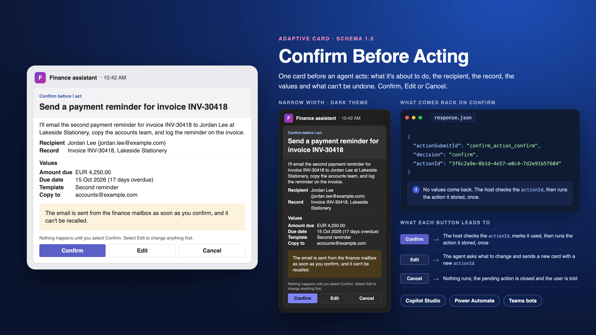

# Confirm Before Acting

## Summary

A card an agent shows just before it does something it can't take back, such as sending an email, updating a record or placing an order. It shows:

- what the agent is about to do, as a title and a one-sentence summary;
- the recipient and the record the action touches;
- up to four values the action will use;
- what happens once it runs, in an amber note, for example "it can't be recalled";
- **Confirm**, **Edit** and **Cancel** buttons.

When the user selects a button, the host gets back the choice and a reference to the pending action, so a topic, a flow or a bot can carry out the action, go back and change it, or drop it.

It only asks. It doesn't hold the pending action, run it, check who answered or show the result afterwards: that is the job of the agent, topic, flow or bot that sends it. [Before you act on a response](#before-you-act-on-a-response) lists what that code must check.



## Choose the right tool

Copilot Studio and Microsoft 365 Copilot can ask for confirmation themselves, so check whether you need a card.

| Where the action runs | Use |
|---|---|
| A tool that a Copilot Studio agent picks with generative orchestration | The tool's own setting first. Under **Additional details**, **Ask the end user before running** is described as "In the end user chat experience, ask the agent for confirmation before running the tool"; it's **No** by default (Add tools to custom agents). Learn doesn't describe what that prompt shows or whether it offers an edit option (as of 1 November 2026). Use this card when the user must see the recipient, record and values in a fixed layout, or must be able to choose **Edit** |
| An API or MCP plugin in a declarative agent for Microsoft 365 Copilot | Copilot's own confirmation. After the first-time prompt, Copilot skips confirmation for HTTP GET operations; "Other HTTP operations prompt the user, showing the data to be sent and giving the user a choice to allow or decline". For an API plugin, keep `x-openai-isConsequential` set to `true` on any operation with side effects: "any action with side effects in the external system should be marked with `true`". For an MCP plugin, don't set `readOnlyHint` to `true` on a tool that changes anything, since that turns its confirmation off (Confirmation prompts for MCP and API plugins). This card isn't needed there |
| A topic in Copilot Studio that calls a tool, a connector or a flow itself | This card, in an **Ask with Adaptive Card** node before the tool runs |
| A Power Automate cloud flow that acts on someone's behalf, or a Teams bot or custom engine agent | This card. An agent flow that a Copilot Studio agent calls as a tool must "respond to the agent within the 100-second action limit" (Add an agent flow as a tool to an agent), so it can only wait for this card after it has responded; see [Power Automate](#power-automate-confirm-from-a-flow-in-teams) |

Microsoft's roadmap also lists "Microsoft Copilot Studio: Enabling makers to require human approval for tool calls" (feature ID 570434): a per-tool switch that pauses a tool call for approve, approve for the session, or deny, shown inline in Teams and Microsoft 365 Copilot. It was listed as in development, with general availability planned for September 2026, and Learn doesn't document it yet (as of 1 November 2026). When it appears in your tenant, check whether it shows the values you need before you build a card for a tool the orchestrator picks.

## What's in the folder

| File | What it's for | Where it goes |
|---|---|---|
| [`card.json`](./card.json) | The card template, schema version 1.5, with 14 `${...}` bindings | Pasted into the host, with the bindings replaced |
| [`data.json`](./data.json) | Made-up sample values for every binding: a payment reminder about to be emailed to a supplier | The Adaptive Cards Designer's sample data pane, or your own code as a model |

## The bindings

Each `${...}` in `card.json` is one value. Replace it, keeping the quotation marks around it. `${actionTitle}` appears twice, once in the heading and once in `fallbackText`, which a client shows when it can't render the card ("Text shown when the client doesn't support the version specified", schema 1.5). `${actionId}` appears three times, once in each button.

| Binding | What goes there | Sample |
|---|---|---|
| `${actionTitle}` | What the agent is about to do, as a short instruction | Send a payment reminder for invoice INV-30418 |
| `${summary}` | One sentence covering everything the action does, including side effects such as logging or notifying someone. Build it from the stored values with a fixed sentence, not from the model's own description, so it can't disagree with the facts below it | I'll email the second payment reminder for invoice INV-30418… |
| `${recipient}` | Who receives the result: a person, a mailbox, a channel. Always include the address or ID the action will use, not only a display name: two people can share a name, and a name the model picked up from a document proves nothing | Jordan Lee (jordan.lee@example.com) |
| `${record}` | The record the action creates, changes or reports on, with its ID | Invoice INV-30418, Lakeside Stationery |
| `${value1Label}` | The name of the first value | Amount due |
| `${value1}` | The first value, exactly as the action will use it. For a change to an existing record, show the old and new value, such as `Net 30 → Net 45` | EUR 4,250.00 |
| `${consequence}` | What happens once the user confirms, and whether it can be undone | The email is sent from the finance mailbox as soon as you confirm… |
| `${actionId}` | Your reference for this pending action, new for every card you send. It doesn't appear on the card; it comes back with the user's choice so you know which pending action was answered | 3f6c2a9e-8b1d-4e57-a0c4-7d2e91b5f604 |

`value2…` to `value4…` work the same way. For fewer values, delete their facts; for more, copy one and number its bindings `value5…`. Leave out a row rather than sending it empty. If the action has no recipient, as for a record update, or no record, as for a chat message, delete that fact.

Show every value the action will use, including every recipient in copy and every attachment. A value that isn't on the card is a value the user didn't confirm.

Rename **Confirm** to the action's own verb, such as **Send** or **Update**, if the card is only ever used for one kind of action. Keep the `id` and `data` as they are.

In Teams, every binding shown on the card is rendered as Markdown: "Markdown is supported in Adaptive Card Textblock field, and Fact.Title and Fact.Value" (Format text in cards). A link written as `[text](https://example.com)` in a value would show as a working link with any text the writer chose. In free text that people typed or a model wrote (`actionTitle`, `summary`, `consequence` and descriptive values), remove `[`, `]`, `*` and `_`. Leave identifiers such as email addresses and record IDs exactly as the action will use them, and check how they render (test 7): changing them would make the card show something other than what runs.

## What comes back

The card has no inputs. When the user selects a button, that button's `data` comes back (Action.Submit "gathers input fields, merges with optional data field, and sends an event to the client", Adaptive Cards schema 1.5):

| Field | Confirm | Edit | Cancel |
|---|---|---|---|
| `actionSubmitId` | `confirm_action_confirm` | `confirm_action_edit` | `confirm_action_cancel` |
| `decision` | `confirm` | `edit` | `cancel` |
| `actionId` | the pending action's reference | the pending action's reference | the pending action's reference |

Each button also has an `id` (`confirm`, `edit`, `cancel`). The response carries no values on purpose: the host runs the action it stored, not what the card sends back. Three buttons are within the "1-3 primary actions" Teams suggests (Designing Adaptive Cards for your app).

**Edit** doesn't open a form. In Copilot Studio or a bot, it hands control back to the agent, which asks what to change, updates the pending action and sends a new card with a new `actionId`. In a Power Automate flow, it ends the request without running anything (see [Power Automate](#power-automate-confirm-from-a-flow-in-teams)).

## Use it

### Copilot Studio: confirm before a topic runs a tool

These steps are for agents on the standard harness, which the Copilot Studio pages cited here describe; topics and the **Ask with Adaptive Card** node belong to it.

1. Collect everything the tool needs in topic variables, with question nodes or with the tool's inputs.
2. Add a **Set a variable value** node for each of two variables:
   - `Topic.PendingActionId`, a new reference, set to `Text(GUID())`. `GUID()` with no argument "creates a new GUID", and the Text function page gives `Text( GUID() )` as the way to turn it into a string; both functions apply to Copilot Studio (GUID function; Text function). Don't name it `ActionId`: the card's own output variable in step 5 is `actionId`, and the two would differ only in case.
   - `Topic.AskedUser`, set to `System.Activity.From.Id`, "the channel-specific unique ID of the sender" of the message that started this step (Variables overview).
3. Add an **Ask with Adaptive Card** node, open **Edit adaptive card**, and paste `card.json` into the card payload editor.
4. In the node's properties, switch to **Formula**. Replace each `"${...}"` string, quotation marks included, with a variable, for example `Topic.ActionTitle`. `fallbackText` holds a binding inside a longer sentence, so join it with `&`, Power Fx's "string concatenation operator" (Power Fx operators). Once you edit the formula, "you can't go back to the original JSON code", so keep `card.json`.
5. Copilot Studio "automatically creates output variables based on the inputs specified in the code", and this card has no inputs. Learn doesn't say whether the buttons' `data` fields are created too (as of 1 November 2026). If `actionSubmitId`, `decision` and `actionId` are missing, select **Edit Schema** and add them as text (Ask questions with Adaptive Cards).
6. Add a **Condition** node, select its three dots (**…**) and **Change to formula**; the formula "must return a Boolean (true or false) value" (Add conditions to topics). Enter:

   ```power
   StartsWith(Topic.actionSubmitId, "confirm_action_") And Topic.actionId = Topic.PendingActionId And System.Activity.From.Id = Topic.AskedUser
   ```

   `StartsWith` applies to Copilot Studio and is case-insensitive (EndsWith and StartsWith functions). In the **All Other Conditions** branch, say the card is out of date or isn't theirs, then use a **Go to step** node to return to the **Ask with Adaptive Card** node (step 3). That sends the current card again, with the same reference, so the person you asked can still answer. Ending the topic there instead would leave their card with nothing waiting for it.
7. In the true branch, branch again on `Topic.decision`:
   - **confirm**: call the tool with the **topic variables**, never with values from the card. Tell the user what happened, including a failure.
   - **edit**: ask what should change, update the variables, then use a **Go to step** node to return to step 2, so the new card has a new reference.
   - **cancel**: say nothing was done, and end the topic.

   The tool runs at most once per pass through the topic, because the card node is no longer waiting once it has an answer. The reference check in step 6 covers the retries and resent cards described next.

If the user types a message instead of selecting a button, Copilot Studio treats it as an invalid response unless it starts another topic, and "for each retry, the card is resent to the user". **Allow switching to another topic** is on by default, and the card is sent again when the other topic ends (Ask questions with Adaptive Cards). Earlier copies can stay clickable ("Some chat clients keep earlier cards clickable", same page), which is why step 6 checks the reference. Learn documents the reprompt for typed text, not for a button selected on an old card when no node is waiting for it; what happens then isn't documented (as of 1 November 2026), so it's test 3.

The sender check matters in Teams group chats, meeting chats and team channels. If you turn on **Use this agent for group and meeting chats** or **Users can add this agent to a team**, everyone in the conversation sees the agent's responses (Connect and configure an agent for Teams and Microsoft Copilot), so anyone there could select **Confirm**.

If the tool also has **Ask the end user before running** set to **Yes**, check in the test pane whether the user is asked twice. Learn doesn't say whether that setting applies when a topic calls the tool (as of 1 November 2026).

The **Edit** loop re-enters the same topic, and Copilot Studio warns about that for some topics: one with "preview cards, confirmation prompts, and connector actions … isn't re-entrant within the same conversation", and "clearing variables or redirecting to the start node doesn't reset this state". Microsoft's workaround is to split the work into a parent topic that loops and a child topic that collects, confirms and runs, and to "redirect between topics to reliably reset conversation state" (Manage topics). If the second pass after Edit skips a step (test 4), build it that way.

Run the tool with the user's own credentials where you can. With **End user** authentication, "this method ensures users only access data they're authorized to see" (Add tools to custom agents). With maker-provided credentials, the user can confirm an action they couldn't do themselves, so check their right to it before you show the card.

### Power Automate: confirm from a flow in Teams

Use this when a cloud flow is about to act on someone's behalf and has to ask them first: a flow that runs on a trigger or a schedule, or an agent flow after it has answered the agent.

An agent flow that a Copilot Studio agent calls as a tool can't wait for the card before answering. It must "respond to the agent within the 100-second action limit", with **Asynchronous response** turned off (Add an agent flow as a tool to an agent). Put **Respond to the agent** first, with a message such as "I've sent you a confirmation card in Teams", and the card after it. Microsoft's advice for that limit: "If some of the cloud flow logic can continue to run after a result is sent to the agent, put these actions after the **Return value(s) to Copilot Studio** step" (Copilot Studio error codes, which uses the action's earlier name). The outcome then goes to the user's chat, not back to the agent. The flow also needs to know whom to post to: pass the user's address from the topic as a flow input, for example `System.User.Email` or `System.User.PrincipalName`, which exist for agents that authenticate with Microsoft (Variables overview). `System.Activity.From.Id` is "channel-specific" and isn't an address a flow can post to.

1. Save the pending action, with its values and a new reference, where the flow can read it back: a Dataverse row, a SharePoint list item, or variables in the same run. Resolve the person you're asking to their user ID, for example with the Office 365 Users action **Get user profile (V2)**, and save that too: the response in step 7 identifies the responder by ID, not by email address.
2. Add the Microsoft Teams action **Post adaptive card and wait for a response**, and post it to the chat of the person the flow acts for. The action "waits for a response from any user" (Microsoft Teams connector reference), so a one-to-one chat is the only place where that user is the person you asked.
3. Paste `card.json` into the action's card field and replace each `${...}` with dynamic content, keeping the quotation marks. Escape any value that can contain a double quotation mark, a backslash or a line break, which is likely for `summary`: improperly formatted JSON is one of the most common problems Microsoft lists for a failed card (Create your first adaptive card). The [Approval Request](../approval-request/README.md#power-automate-send-the-request-to-an-approver-in-teams) card gives an expression that does this.
4. Among the action's inputs, fill in **Update message** and set **Should update card** to Yes, for example "Thanks, your answer has been received. The result follows in this chat." The connector reference describes this action's inputs only as dynamic, so find the two fields in the designer. Without them the card "resets and then appears exactly the same", and update messages are "recommended to update others and prevent consumers from attempting to submit the card more than once" (Overview of adaptive cards for Microsoft Teams).
5. Plan for no answer: a run can last 30 days, and "after 30 days, any pending steps time out" (Limits of automated, scheduled, and instant flows). Most pending actions shouldn't wait that long; add a branch that cancels the action once your own deadline passes.
6. Branch on the response. The connector reference doesn't document how the selected button appears in the action's outputs (as of 1 November 2026), so run the flow once and read the outputs in the run history before you build the condition: look for `decision`, `actionId` and `actionSubmitId`, and the button's `id`.
7. Compare the responder's ID with the one you saved in step 1. The response gives "the user ID of the person submitting the card", and "it might be necessary to include the Office 365 Users connector to complete desired profile information for the user who submitted the card" (Overview of adaptive cards for Microsoft Teams). If they differ, post that the card wasn't theirs and run nothing. Then branch:
   - **confirm**: read the pending action back by `actionId`, mark it used, and run it.
   - **edit**: the card can't collect the change, so mark the pending action as needing changes and tell the user how to ask again, for example by asking the agent. Run nothing.
   - **cancel**: mark the pending action cancelled.

   In every branch, post a message saying what happened.

A wait-for-response card "can only be submitted once per card", and "any further submissions are ignored". "The user ID of the person submitting the card" is available in the dynamic content after the action (Overview of adaptive cards for Microsoft Teams). Don't post this card to a channel or a group chat: in a channel, "the flow continues once anyone in the Teams channel responds".

A card posted without waiting can't collect a choice: "Adaptive cards that don't wait return an error for all button actions except OpenURL".

### A Teams bot or custom engine agent

Expand the template with your data, then send the result. In JavaScript, with the `adaptivecards-templating` package:

```js
import * as ACData from "adaptivecards-templating";

const card = new ACData.Template(template).expand({ $root: pendingAction });
```

The .NET package is `AdaptiveCards.Templating`. For an `Action.Submit`, "with BotFramework bots, the client would send an activity through the messaging medium to the bot" (Adaptive Cards schema 1.5); the button's `data`, the fields in [What comes back](#what-comes-back), arrive in that activity.

For a card sent only by a Teams bot, Teams recommends `Action.Execute`: its actions table calls `Action.Submit` a "Legacy action type. Prefer Action.Execute for new projects" (Adaptive Card actions in Teams SDK). It suits this card well: the handler can return a card that replaces the buttons with the outcome, such as "Sent at 10:42", so the original can't be clicked again. The [Approval Request](../approval-request/README.md#a-teams-bot-or-custom-engine-agent) card gives the steps; use the verbs `confirm`, `edit` and `cancel`. Keep `Action.Submit` if the same card is also used in Copilot Studio: Bot Framework Web Chat "doesn't support `Action.Execute`" (Ask questions with Adaptive Cards), and neither does a Copilot Studio agent in Microsoft Copilot (Connect and configure an agent for Teams and Microsoft Copilot).

### Try it without a host

Open the [Adaptive Cards Designer](https://adaptivecards.microsoft.com/designer), paste `card.json` into the card payload editor and `data.json` into the sample data editor, and switch to preview mode.

## Before you act on a response

The response comes from the user's client, so treat every field as input, not proof. Copilot Studio says so for its own cards: a fixed `actionSubmitId` "doesn't uniquely identify every rendered instance of the card or automatically prevent duplicate submissions", and making a card read-only "is a client-side usability measure, not a replacement for validating submissions in your agent or service" (Ask questions with Adaptive Cards).

1. **The card.** `actionSubmitId` is one of `confirm_action_confirm`, `confirm_action_edit` or `confirm_action_cancel`.
2. **The pending action.** `actionId` matches an action that is still pending and hasn't expired. Mark it used in the same step as the check, before you run it, so a double click, a retry or an earlier copy of the card can't run it twice.
3. **The person.** The responder is the person the action was proposed to: compare `System.Activity.From.Id` (Copilot Studio), the responder's user ID (Power Automate) or the activity's sender (a bot) with the ID you saved when you asked, not with a name on the card. In a group chat, meeting chat or channel, anyone in it can select a button. Check that they're allowed to do the action, above all when it runs with the agent's own credentials.
4. **The values.** Run the action with the values you stored when you sent the card. The response carries none, and nothing in it should change what runs. If the record changed since the card was sent, such as an invoice paid in the meantime, don't run the action; send a new card.
5. **The outcome.** Tell the user what happened: done, with a reference they can check; failed, and why; or cancelled, with nothing done. Store who confirmed, when, the reference and the values in your own system. The card keeps no history.

## Test plan

Run these in your tenant before relying on the card. None of them have been run for this release.

| # | Test | Pass when |
|---|---|---|
| 1 | Show the card in Teams desktop and Teams mobile, in light and dark themes | Nothing is cut off at narrow widths, and the three buttons fit or wrap readably |
| 2 | Select Confirm | The action runs once, with the stored values, and the user is told the result |
| 3 | Select Confirm twice quickly, then select Confirm on an earlier copy of the card, both while the topic is waiting and after it has finished | The action runs once; the later clicks are ignored or answered with "out of date", and you know what the agent does with a click that arrives when nothing is waiting |
| 4 | Select Edit, change one value, then confirm the new card; in Copilot Studio, do it twice in one conversation | The new card has a new reference and the new value, Confirm on the old card does nothing, and the second pass asks and runs every step again |
| 5 | Select Cancel | Nothing runs, and the user is told so |
| 6 | In Copilot Studio, type a message instead of selecting a button | The card is resent or another topic starts, and nothing runs |
| 7 | Send a `summary` and a value containing `"`, `\`, a line break, `*` and `[text](https://example.com)` | The card posts, nothing turns bold, and no link shows |
| 8 | Show the card in a group chat with a second test account (Copilot Studio with **Use this agent for group and meeting chats** on, or a bot), and answer from that account | The response is rejected; only the person you asked can confirm |
| 9 | Call an agent flow that posts the card from a Copilot Studio agent, and wait more than 100 seconds before answering | The agent got its answer before the card was posted, and the flow still runs the action after Confirm |
| 10 | In the Teams and Microsoft Copilot channel and on a website | The card renders and all three buttons submit |
| 11 | With a screen reader | The title and "Values" are announced as headings, and the facts and note are read in order before the buttons |

## Prerequisites

- **Copilot Studio:** an agent on the standard harness with a topic you can add an Ask with Adaptive Card node to, and the tool, connector or flow the topic calls after Confirm.
- **Power Automate:** the Workflows app, which the connector's actions "require" to be installed and set "to the 'allow' state in the Teams admin center"; the Flow bot poster isn't available in GCC, GCC High or DoD tenants, so post as a user there (Microsoft Teams connector reference). You also need somewhere to store the pending action between posting the card and the response.
- **A bot or agent:** the Microsoft 365 Agents SDK or the Teams SDK, and `adaptivecards-templating` 2.3.1 or `AdaptiveCards.Templating` to fill in the bindings.

## Limitations

- **Four values, fixed.** The repository's cards use plain bindings so they can be filled in by hand, which rules out repeating a row for each item in a list. For more values, add rows; for a long list, such as twenty order lines, put a total on the card and link to the full list from your own system.
- **No editing on the card.** Edit hands control back to the agent, or in a flow ends the request, instead of showing input fields. Inputs on the card would come back with the response, and the host would then be running values from the client, which [Before you act on a response](#before-you-act-on-a-response) rules out.
- **Schema version 1.5.** Copilot Studio supports 1.6 and earlier, but says Teams and the live chat widget are "limited to version 1.5" (Ask questions with Adaptive Cards, 21 October 2026). The Teams Cards reference says "Teams platform supports v1.6 or earlier of Adaptive Card features for bot sent cards and action based message extensions" (13 October 2026). The two pages disagree, so the card stays at 1.5, which both accept. It needs 1.5 for the headings' `"style": "heading"`.
- **Colours depend on the host.** "Positive or destructive action styling is not supported in Adaptive Cards on the Teams platform" (Cards reference), so in Teams the Confirm button looks like the others; its text carries the meaning. The amber note uses the 1.5 `warning` container style, whose colour each host chooses. The preview image uses colours chosen for it.
- **No expiry on the card.** The card can't disable itself. Expiring a pending action is up to the host, in check 2.
- **English only.** "Confirm before I act", "Recipient", "Record", "Values", the footer, the button titles and `fallbackText` are in English, and the root `lang` is `en`. Translate them for another audience.
- **Not for webhooks, channels or group chats.** A card posted without waiting can't collect a response, and in a channel or group chat anyone can answer. Send it to the one person who has to confirm, in a one-to-one chat.
- **Size.** 3.4 KB filled in with the sample data, far below the "approximately 28 KB" at which Power Automate's Teams actions fail (Microsoft Teams connector reference).
- **Not tested in a tenant.** The card was checked against the Adaptive Cards 1.5 JSON schema with the sample data filled in, and rendered with the Adaptive Cards JavaScript renderer 3.0.6 for the preview image. It hasn't been shown from a Copilot Studio agent, a flow or a bot; run the [test plan](#test-plan) first.

## Sources

Microsoft Learn, with each page's `ms.date` when it was read on 31 October or 1 November 2026:

- [Add tools to custom agents (Copilot Studio)](https://learn.microsoft.com/en-us/microsoft-copilot-studio/add-tools-custom-agent), 1 Oct 2026
- [Ask questions with Adaptive Cards (Copilot Studio)](https://learn.microsoft.com/en-us/microsoft-copilot-studio/authoring-ask-with-adaptive-card), 21 Oct 2026
- [Connect and configure an agent for Teams and Microsoft Copilot](https://learn.microsoft.com/en-us/microsoft-copilot-studio/publication-add-bot-to-microsoft-teams), 29 Oct 2026
- [Confirmation prompts for MCP and API plugins for Microsoft 365 Copilot](https://learn.microsoft.com/en-us/microsoft-365/copilot/extensibility/plugin-confirmation-prompts), 14 Jul 2026
- [Add an agent flow as a tool to an agent (Copilot Studio)](https://learn.microsoft.com/en-us/microsoft-copilot-studio/flow-agent), 18 Jun 2026
- [Resolve agent error codes in Copilot Studio](https://learn.microsoft.com/en-us/troubleshoot/power-platform/copilot-studio/authoring/error-codes), 28 Oct 2026: `FlowActionTimedOut`
- [Add conditions to topics (Copilot Studio)](https://learn.microsoft.com/en-us/microsoft-copilot-studio/authoring-using-conditions), 11 Oct 2024
- [Manage topics (Copilot Studio)](https://learn.microsoft.com/en-us/microsoft-copilot-studio/authoring-topic-management), 3 Mar 2026: conversation state when re-invoking topics
- [Variables overview (Copilot Studio)](https://learn.microsoft.com/en-us/microsoft-copilot-studio/authoring-variables-about), 30 Jun 2026
- [GUID function (Power Fx)](https://learn.microsoft.com/en-us/power-platform/power-fx/reference/function-guid), 18 Jun 2025
- [Text function (Power Fx)](https://learn.microsoft.com/en-us/power-platform/power-fx/reference/function-text), 18 Jun 2025
- [Power Fx operators](https://learn.microsoft.com/en-us/power-platform/power-fx/operators), 22 Mar 2024
- [EndsWith and StartsWith functions (Power Fx)](https://learn.microsoft.com/en-us/power-platform/power-fx/reference/function-startswith), 10 Jun 2024
- [Overview of adaptive cards for Microsoft Teams (Power Automate)](https://learn.microsoft.com/en-us/power-automate/overview-adaptive-cards), 19 Aug 2026
- [Create your first adaptive card (Power Automate)](https://learn.microsoft.com/en-us/power-automate/create-adaptive-cards), 19 Aug 2026
- [Limits of automated, scheduled, and instant flows](https://learn.microsoft.com/en-us/power-automate/limits-and-config), 17 Jul 2026
- [Microsoft Teams connector reference](https://learn.microsoft.com/en-us/connectors/teams/), `ms.date` 1 Mar 2024; the generated reference's own updated date is 2 Oct 2026
- [Create and explore card types in Teams (Cards reference)](https://learn.microsoft.com/en-us/microsoftteams/platform/task-modules-and-cards/cards/cards-reference), 13 Oct 2026
- [Adaptive Card actions in Teams SDK](https://learn.microsoft.com/en-us/microsoftteams/platform/task-modules-and-cards/cards/cards-actions), 10 Jun 2026
- [Designing Adaptive Cards for your app](https://learn.microsoft.com/en-us/microsoftteams/platform/task-modules-and-cards/cards/design-effective-cards), 5 Aug 2026
- [Format text in cards](https://learn.microsoft.com/en-us/microsoftteams/platform/task-modules-and-cards/cards/cards-format), 22 Oct 2026
- [Adaptive Card Templating SDKs](https://learn.microsoft.com/en-us/adaptive-cards/templating/sdk), 15 May 2020

The Teams card pages above carry a notice that they are "considered legacy" and point to the [Adaptive Cards documentation hub](https://adaptivecards.microsoft.com/) for the current schema reference, Designer and samples. The hub is a web app without dated pages, so the card's facts are cited from Learn and from the published schema below.

Other sources, read on 1 November 2026:

- [Microsoft 365 roadmap, feature ID 570434](https://www.microsoft.com/microsoft-365/roadmap?id=570434), published 1 Sep 2026: status "In development", general availability "September CY2026". The roadmap page didn't show the item when read, so it was read through its mirror at [mc.merill.net](https://mc.merill.net/message/RM570434)
- [Adaptive Cards 1.5 JSON schema](https://github.com/microsoft/AdaptiveCards/blob/main/schemas/1.5.0/adaptive-card.json), last changed 15 Nov 2021: the `Action.Submit`, `ActionStyle`, `ContainerStyle` and `fallbackText` definitions
- [adaptivecards](https://www.npmjs.com/package/adaptivecards) 3.0.6 (7 Apr 2026) and [adaptivecards-templating](https://www.npmjs.com/package/adaptivecards-templating) 2.3.1 (20 Sep 2022), used to render the preview and check the bindings

## Contributors

| Name | Links |
| --- | --- |
| Arindam Choudhury | [GitHub](https://github.com/ari20089) · [LinkedIn](https://www.linkedin.com/in/arindam-choudhury/) |

## Version history

| Version | Date | Comments |
| --- | --- | --- |
| 1.0 | November 2026 | Initial release |

## Help

Adaptive Cards here are community samples without support. Search [existing issues](https://github.com/ari20089/agents-in-practice/issues) or [open a new one](https://github.com/ari20089/agents-in-practice/issues/new/choose). For Microsoft product questions use Microsoft Learn or your Microsoft support channel.

## Disclaimer

**THIS CODE IS PROVIDED _AS IS_ WITHOUT WARRANTY OF ANY KIND, EITHER EXPRESS OR IMPLIED, INCLUDING ANY IMPLIED WARRANTIES OF FITNESS FOR A PARTICULAR PURPOSE, MERCHANTABILITY, OR NON-INFRINGEMENT.**
