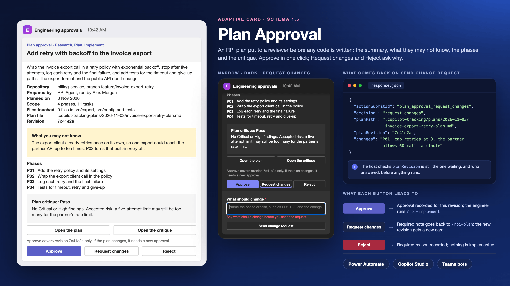

# Plan Approval

## Summary

A card that asks a reviewer to approve an implementation plan before any code is written. It is shaped for plans from the Research, Plan, Implement (RPI) workflow in [HVE Core](https://github.com/microsoft/hve-core), Microsoft's HyperVelocity Engineering framework for GitHub Copilot, and works for any plan with phases and a review. It shows:

- the plan's title and its executive summary;
- the repository and branch, who prepared it, when, its scope, the files it touches, the plan file and the revision being approved;
- the plan's "What You May Not Know" note, in an amber box;
- the first four phases, by their `Pxx` IDs;
- the plan critique's result, with a one-line note;
- links to the plan and the critique;
- **Approve**, **Request changes** and **Reject**. Request changes and Reject each open a short form with a required box, so the reviewer has to say what to change or why not before the answer is sent.

When the reviewer answers, the host gets back the decision, the plan file and the revision, plus the requested change or the reason, in one response. A flow, a topic or a bot can then record the approval, send the change request back to the planner, or close the task.

It only asks. It doesn't run RPI, start `/rpi-implement`, check who answered or record the decision: that is the job of the flow, topic or bot that sends it. [Before you rely on a response](#before-you-rely-on-a-response) lists what that code must check, and [Make RPI wait for the approval](#make-rpi-wait-for-the-approval) shows how to stop RPI implementing an unapproved plan.



## Choose the right tool

| You need | Use |
|---|---|
| The person running RPI to confirm each step themselves | RPI's own manual mode. `RPI Agent` "stays in the active phase until you invoke the next `/rpi-*` command or select a phase handoff" (Using RPI together). No card needed |
| A plan reviewed where the code is reviewed, by people who already review the pull request | A review on the pull request that carries the plan, if your branch rules already require one |
| A standard approval with history kept for you, one or more approvers, no plan-specific layout | Power Automate's **Start and wait for an approval** action. Approvals are saved in Dataverse (Get started with Power Automate approvals) |
| A named reviewer, often a tech lead or code owner, to approve a specific revision in Teams or in an agent, with the plan's phases and critique in front of them and a reason required for a no | This card |

## Where it fits in RPI

HVE Core's RPI lifecycle runs "Task context and evidence → Research when needed → Plan → Implement → Review → Follow-up" (RPI documentation). The Plan phase writes the plan, and by default an independent critique:

| File | Path |
|---|---|
| The plan | `.copilot-tracking/plans/{{YYYY-MM-DD}}/{{task_slug}}-plan.md` (RPI documentation; `rpi-plan` skill) |
| The critique | `.copilot-tracking/reviews/plans/{{YYYY-MM-DD}}/{{task_slug}}-plan-critique.md` by default (RPI documentation). The `rpi-plan-critique` skill writes to whatever path its caller gives it |

The plan "presents its Executive Summary, What You May Not Know, and Phase Checklist before user direction", phases have stable `Pxx` IDs and tasks `Pxx-Txx` IDs (`rpi-plan` skill; RPI documentation). The card maps onto that: `summary` from the Executive Summary, `whatYouMayNotKnow` from What You May Not Know, the phases from the Phase Checklist.

The critique returns one of three dispositions (`rpi-plan-critique` skill):

| Disposition | HVE Core's definition |
|---|---|
| `Pass` | "the plan is credible for implementation, no Critical or High finding applies, and any residual risks are explicitly accepted" |
| `Revise` | "substantive findings require a plan change; the parent disposes the findings" |
| `Blocked` | "supplied evidence cannot support a decision-critical assessment" |

Send the card when the critique is `Pass`. The critique can also be skipped with `critique=skip` (RPI documentation; `rpi-plan` skill), and for RPI "a skipped or absent critique is not a blocker" (`rpi-implement` skill); whether a reviewer may approve an unreviewed plan is your team's call, so the card shows `Skipped` rather than hiding it. Don't send it for `Revise` or `Blocked`: the planner revises first.

### Make RPI wait for the approval

RPI doesn't treat its own readiness as a sign-off: "An approved plan is an implementation-ready plan for the declared scope, not a human sign-off", and "A direct `/rpi-implement` request needs no additional plan-approval prompt". Human review applies "only when an instruction, domain artifact, or explicit user requirement names it for the affected action" (`rpi-implement` skill). So unless something names it, RPI implements a ready plan whether or not anyone answered this card.

Name it in your repository's custom instructions, such as `.github/copilot-instructions.md` or an `AGENTS.md` file (Adding repository custom instructions for GitHub Copilot). "The harness determines which instruction files it reads" (Use custom instructions in VS Code), so check that the file you choose is one the harness you run RPI in loads:

```markdown
## Plan approval before implementation

Implementing an RPI plan requires human review of that plan by a named reviewer.
Before `/rpi-implement` or RPI Agent changes source files for a plan, ask the user to confirm that the plan's current revision has a recorded Approve decision from a reviewer other than the plan's author.
If there is no approval, or the plan changed after it was approved, stop and say the plan is waiting for approval.
The plan critique and the agent's own checks are not this approval.
```

The instruction makes the agent stop and ask; it can't see the Teams answer. If you record approvals where the agent can read them, such as a comment on the pull request, name that place in the instruction. HVE Core says automatic mode "still stops for blockers, required human review, and any destructive or externally visible action" (Using RPI together); check that it stops for this instruction too (test 12).

## What's in the folder

| File | What it's for | Where it goes |
|---|---|---|
| [`card.json`](./card.json) | The card template, schema version 1.5, with 22 `${...}` bindings | Pasted into the host, with the bindings replaced |
| [`data.json`](./data.json) | Made-up sample values for every binding: a four-phase plan to add retries to an invoice export | The Adaptive Cards Designer's sample data pane, or your own code as a model |
| [`assets/preview.png`](./assets/preview.png) | The preview image | The gallery; not pasted anywhere |

## The bindings

Each `${...}` in `card.json` is one value. Replace it, keeping the quotation marks around it. `${planRevision}` appears six times (the facts, the footer, `fallbackText` and the three submit buttons) and `${planPath}` four. `${planTitle}` and `${planUrl}` also appear in `fallbackText`, the text a client shows when it can't render the card ("Text shown when the client doesn't support the version specified", schema 1.5).

| Binding | What goes there | Sample |
|---|---|---|
| `${planTitle}` | The plan's title, one line | Add retry with backoff to the invoice export |
| `${summary}` | Two or three sentences from the Executive Summary: what changes and what doesn't | Wrap the invoice export call in a retry policy… |
| `${repository}` | The repository and the branch the work will land on | billing-service, branch feature/invoice-export-retry |
| `${preparedBy}` | Who ran the Plan phase, and with what | RPI Agent, run by Alex Morgan |
| `${createdOn}` | When the plan was written, already formatted as text | 3 Nov 2026 |
| `${scope}` | How many phases and tasks the plan has | 4 phases, 11 tasks |
| `${filesTouched}` | How many files the tasks link to, and where. RPI tasks link to the files they touch (RPI documentation) | 9 files in src/export, src/config and tests |
| `${planPath}` | The plan file's path in the repository. It comes back with the decision | .copilot-tracking/plans/2026-11-03/invoice-export-retry-plan.md |
| `${planRevision}` | The commit, or a hash of the file, that identifies **this** version of the plan. It comes back with the decision, so an approval can't carry over to a later edit | 7c41e2a |
| `${whatYouMayNotKnow}` | The plan's What You May Not Know section, shortened to the point a reviewer most needs | The export client already retries once on its own… |
| `${phase1Id}` | The first phase's ID from the Phase Checklist | P01 |
| `${phase1Title}` | The first phase's title | Add the retry policy and its settings |
| `${critiqueResult}` | `Pass`, or `Skipped` when the critique was skipped. See [Where it fits in RPI](#where-it-fits-in-rpi) | Pass |
| `${critiqueNote}` | One line from the critique: its Critical and High findings, or "none", and any residual risk it accepted | No Critical or High findings. Accepted risk: … |
| `${planUrl}` | A full `https://` link to the plan file **at that revision**, so the reviewer reads exactly what they approve | https://example.com/billing-service/blob/7c41e2a/… |
| `${critiqueUrl}` | A full `https://` link to the critique at the same revision | https://example.com/billing-service/blob/7c41e2a/… |

`phase2…` to `phase4…` work the same way. For fewer phases, delete their facts; for more, add facts, or keep four and make the last one, for example, `P04–P06` with "3 more phases, see the plan". Leave out a row rather than sending it empty. If the plan has nothing under What You May Not Know, delete the amber container. If the critique was skipped, keep the critique block with `Skipped`, so the reviewer knows no one checked the plan, and delete **Open the critique**.

The plan lives in `.copilot-tracking/` in the workspace where RPI ran, and HVE Core tells you to add that folder to `.gitignore`: its agents "create ephemeral workflow artifacts in a `.copilot-tracking/` folder within your project" (Using the HVE Core extension). So the plan isn't in the repository by default, and the reviewer can only open it if you publish it, for example by committing it on the branch or attaching it to the pull request. Build both links in your own system from the repository and the revision. Never take a link from the plan's own text: it goes into the button as is, and the reviewer trusts it because the card came from your flow or bot.

In Teams, every binding shown on the card is rendered as Markdown: "Markdown is supported in Adaptive Card Textblock field, and Fact.Title and Fact.Value" (Format text in cards). The title, summary, note, phase titles and critique note are written by a model, so remove `[`, `]`, `*` and `_` from them. A task slug with underscores in `${planPath}` can turn italic on the card; check how it renders (test 8), but send the exact path back in the buttons' `data`.

## What comes back

**Approve** is a submit button on the card itself. **Request changes** and **Reject** are `Action.ShowCard` buttons: each opens a small card under the buttons with a required box and its own submit button, **Send change request** or **Reject plan**. A submit sends the inputs on its own card and its parent cards, but "Inputs will **not** be validated or submitted if they are on a card that is a child or sibling card of the card containing the Action.Submit" (Input Validation). So Approve never waits for, or sends, the text boxes, and each form sends only its own box.

The inputs are merged with the button's `data` (Action.Submit "gathers input fields, merges with optional data field, and sends an event to the client", Adaptive Cards schema 1.5):

| Field | Approve | Send change request | Reject plan |
|---|---|---|---|
| `actionSubmitId` | `plan_approval_approve` | `plan_approval_request_changes` | `plan_approval_reject` |
| `decision` | `approve` | `request_changes` | `reject` |
| `planPath` | the plan file | the plan file | the plan file |
| `planRevision` | the revision on the card | the revision on the card | the revision on the card |
| `changes` | not sent | what should change, required | not sent |
| `reason` | not sent | not sent | why the plan is rejected, required |

The submit buttons' `id`s are `approve`, `sendChanges` and `confirmReject`; the two form buttons are `requestChanges` and `reject`. **Open the plan** and **Open the critique** open their links and send nothing back. They sit in the body, so the card keeps three primary actions: "As a best practice, include 1-3 primary actions. You can have up to six" (Designing Adaptive Cards for your app).

`isRequired` and `errorMessage` are checked by the client before it sends anything (Input Validation). That helps the reviewer; it isn't a guarantee. Check again in the host (check 4).

## Use it

### Power Automate: ask a reviewer in Teams

Use this when a plan is ready and a named person has to approve it before implementation starts.

1. Start the flow from whatever knows the plan is ready: a manual trigger the engineer runs with the plan's path and revision, or a trigger on your repository. The card needs only the values in [The bindings](#the-bindings).
2. Resolve the reviewer to their user ID, for example with the Office 365 Users action **Get user profile (V2)**, and save it with `planPath` and `planRevision` where the flow can read them back.
3. Add the Microsoft Teams action **Post adaptive card and wait for a response** and post it to the reviewer's chat. The action "waits for a response from any user" (Microsoft Teams connector reference), and in a channel "the flow continues once anyone in the Teams channel responds" (Overview of adaptive cards for Microsoft Teams), so post to a channel only if anyone in it may approve. The older per-user and per-channel actions are marked deprecated.
4. Paste `card.json` into the action's card field and replace each `${...}` with dynamic content, keeping the quotation marks. Escape any value that can contain a double quotation mark, a backslash or a line break, which is likely for `summary`, `whatYouMayNotKnow` and `critiqueNote`: improperly formatted JSON is one of the most common problems Microsoft lists for a failed card (Create your first adaptive card). The [Approval Request](../approval-request/README.md#power-automate-send-the-request-to-an-approver-in-teams) card gives an expression that does this.
5. Fill in **Update message** and set **Should update card** to Yes, for example "Thanks, your decision on revision 7c41e2a has been recorded." Without them the card "resets and then appears exactly the same" (Overview of adaptive cards for Microsoft Teams).
6. Plan for no answer: a run can last 30 days, and "after 30 days, any pending steps time out" (Limits of automated, scheduled, and instant flows). Add a branch that reminds or reassigns once your own deadline passes.
7. Branch on the response after the checks in [Before you rely on a response](#before-you-rely-on-a-response). "The outputs of this operation are dynamic" (Microsoft Teams connector reference), and the Power Automate pages don't say how inputs from an `Action.ShowCard` form appear in them (as of 4 November 2026), so run the flow once for each button and read the outputs in the run history before you build the conditions. Then:
   - **approve**: record the approval against the plan and revision, and tell the engineer that implementation can start, for example in their chat or as a comment on the pull request.
   - **request_changes**: send `changes` to the engineer, who passes it to `/rpi-plan` to revise the plan. The revised plan has a new revision and needs a new card.
   - **reject**: record `reason` and tell the engineer the task is closed or needs a new approach.

A wait-for-response card "can only be submitted once per card", and "any further submissions are ignored" (Overview of adaptive cards for Microsoft Teams).

### Copilot Studio: review plans in a topic

These steps are for agents on the standard harness, which the Copilot Studio pages cited here describe; topics and the **Ask with Adaptive Card** node belong to it.

The card goes to whoever is chatting with the agent, so this suits an agent that a reviewer talks to, such as "show me the plans waiting for my approval". To send a plan to someone else, call a flow from the topic and follow the Power Automate steps.

1. Load the plan's values into topic variables, for example from a Dataverse table or SharePoint list where your process keeps plans waiting for review. Save the revision and path you're showing as `Topic.PendingRevision` and `Topic.PendingPlanPath`.
2. Add an **Ask with Adaptive Card** node, open **Edit adaptive card**, and paste `card.json` into the card payload editor.
3. In the node's properties, switch to **Formula** and replace each `"${...}"` string, quotation marks included, with a variable. `fallbackText`, the footer and the critique heading hold bindings inside longer text, so join them with `&`. Once you edit the formula, "you can't go back to the original JSON code", so keep `card.json` (Ask questions with Adaptive Cards).
4. Copilot Studio "automatically creates output variables based on the inputs specified in the code". Learn doesn't say whether that includes inputs inside an `Action.ShowCard` form or the buttons' `data` (as of 4 November 2026). If `changes`, `reason`, `decision`, `planPath`, `planRevision` or `actionSubmitId` are missing, add them as text with **Edit Schema**.
5. Add a **Condition** node, select **Change to formula**, and enter:

   ```power
   StartsWith(Topic.actionSubmitId, "plan_approval_") And Topic.planRevision = Topic.PendingRevision And Topic.planPath = Topic.PendingPlanPath
   ```

   The formula "must return a Boolean (true or false) value" (Add conditions to topics). In the other branch, say the card is out of date and show the current one. Then check that the signed-in user may approve plans for this repository, and isn't the plan's author.
6. Branch on `Topic.decision`. If `changes` or `reason` is empty for `request_changes` or `reject`, ask for it with a question node before you record anything.

"Some chat clients keep earlier cards clickable", and "for each retry, the card is resent to the user" (Ask questions with Adaptive Cards), which is why step 5 compares the revision with the one still waiting.

In the Teams and Microsoft Copilot channels, Microsoft Copilot doesn't support "Adaptive Cards with `Action.Execute`" (this card uses `Action.Submit`) and "might remove embedded URLs" (Connect and configure an agent for Teams and Microsoft Copilot), so check that **Open the plan** still opens there (test 10). If you turn on **Use this agent for group and meeting chats** or **Users can add this agent to a team**, everyone in that conversation sees the card and can answer it; keep plan approval in one-to-one chats.

### A Teams bot or custom engine agent

Expand the template with your data, then send the result. In JavaScript, with the `adaptivecards-templating` package:

```js
import * as ACData from "adaptivecards-templating";

const card = new ACData.Template(template).expand({ $root: plan });
```

The .NET package is `AdaptiveCards.Templating`. The fields in [What comes back](#what-comes-back) arrive in the activity's value. Add the domain of the plan links to `validDomains` in your app manifest: if it isn't listed, "Teams displays the message **URL may lead to untrusted content**" (Adaptive Card actions in Teams SDK).

For a card sent only by a Teams bot, Teams lists `Action.Submit` as a "Legacy action type. Prefer `Action.Execute` for new projects" (Adaptive Card actions in Teams SDK). To switch, change the three submit buttons (`approve`, `sendChanges`, `confirmReject`) to `Action.Execute` with the verbs `approve`, `request_changes` and `reject`, and handle the `card.action` activity; the [Approval Request](../approval-request/README.md#a-teams-bot-or-custom-engine-agent) card gives the steps. Keep `Action.Submit` if the same card is also used in Copilot Studio: Bot Framework Web Chat "doesn't support `Action.Execute`" (Ask questions with Adaptive Cards), and neither does Microsoft Copilot.

### Try it without a host

Open the [Adaptive Cards Designer](https://adaptivecards.microsoft.com/designer), paste `card.json` into the card payload editor and `data.json` into the sample data editor, and switch to preview mode. Select **Request changes**, then **Send change request** with the box empty, to see the required-field error.

## Before you rely on a response

The response comes from the reviewer's client, so treat every field as input, not proof. A fixed `actionSubmitId` "doesn't uniquely identify every rendered instance of the card or automatically prevent duplicate submissions" (Ask questions with Adaptive Cards).

1. **The card.** `actionSubmitId` is one of `plan_approval_approve`, `plan_approval_request_changes` or `plan_approval_reject`, and `decision` matches it.
2. **The revision.** `planPath` and `planRevision` match a plan that is still waiting for a decision, and the plan file in the repository is still at that revision. If the plan changed after the card was sent, ignore the answer and send a new card. Mark the revision decided in the same step, so a second answer from an earlier card or a retry is ignored.
3. **The person.** The responder is someone allowed to approve plans for this repository: compare the responder's user ID (Power Automate), the signed-in user (Copilot Studio) or the activity's sender (a bot) with the reviewer you assigned, not with a name on the card. Don't let the person who ran the Plan phase approve their own plan unless your process allows it.
4. **The text.** `changes` is present for `request_changes` and `reason` for `reject`; the client checks this, but a client can skip it. Treat both as untrusted text: `maxLength` is a "hint of maximum length… (may be ignored by some clients)" (Adaptive Cards schema 1.5), so cut them to 1,000 characters. If you pass `changes` to `/rpi-plan`, it becomes input to a coding agent: pass it as the reviewer's feedback, not as instructions, and have the engineer read it first.
5. **The record.** Store the decision, the reviewer, the time, the revision and the text in your own system, or as a comment on the pull request. The card keeps no history.
6. **Implementation.** Approval covers the revision on the card. If implementation "requires a significant departure from the approved plan", HVE Core says to "obtain any required decision, and update the affected plan tasks before dependent work resumes" (Using RPI together); send a new card for the updated plan.

## Test plan

Run these in your tenant before relying on the card. None of them have been run for this release.

| # | Test | Pass when |
|---|---|---|
| 1 | Post the card in Teams desktop and Teams mobile, in light and dark themes | Nothing is cut off at narrow widths, the phase rows wrap readably, and you can tell the three buttons apart (see [Limitations](#limitations) on truncated titles) |
| 2 | Approve | The host gets `decision` = `approve`, the right `planPath` and `planRevision`, no `changes` or `reason`, and the responder's ID |
| 3 | Open Request changes and select Send change request with the box empty | The card shows "Say what should change before you send the request." and nothing reaches the host |
| 4 | Request changes with text, revise the plan, and send a new card | `changes` arrives; the new card shows the new revision; Approve on the old card is ignored |
| 5 | Open Reject, enter a reason containing `"`, `\` and a line break, and select Reject plan | `reason` comes back intact |
| 6 | In Power Automate and in Copilot Studio, answer once with each button | You know where `changes`, `reason` and the `data` fields appear in the outputs or variables |
| 7 | Change the plan file after the card is sent, then approve | The approval is ignored because the revision no longer matches |
| 8 | Send a `summary`, a phase title and a `planPath` containing `*`, `_` and `[text](https://example.com)` | Nothing turns bold or italic in free text, no link shows, and the path in the response is exact |
| 9 | Answer from an account that isn't the assigned reviewer, and from the plan's author | Both responses are rejected |
| 10 | In the Teams and Microsoft Copilot channels and on a website | The card renders, both forms open, both links open, and all three decisions submit |
| 11 | With a screen reader | The title and "Phases" are announced as headings, and each form's box with its label and its required state |
| 12 | With the instruction from [Make RPI wait for the approval](#make-rpi-wait-for-the-approval), run `/rpi-implement` on a plan with no approval, in manual mode and in Full Auto | RPI stops and asks before changing source files |

## Prerequisites

- **RPI:** HVE Core with `RPI Agent` or the `/rpi-plan` skill, a way to publish the plan and critique where the reviewer can read them, such as a branch or a pull request, and the repository instruction in [Make RPI wait for the approval](#make-rpi-wait-for-the-approval).
- **Power Automate:** the Teams actions "require Workflows (formerly Power Automate) app availability" and the app set to "allow" in the Teams admin center. "The **Flow Bot** poster option is available only in commercial tenants"; in GCC, GCC High and DoD tenants, post as a user (Microsoft Teams connector reference).
- **Copilot Studio:** an agent on the standard harness with a topic you can add an Ask with Adaptive Card node to, and somewhere it can read the plans waiting for review.
- **A bot or agent:** the Microsoft 365 Agents SDK or the Teams SDK, and `adaptivecards-templating` 2.3.1 or `AdaptiveCards.Templating` to fill in the bindings.

## Limitations

- **Long button titles get cut off at narrow widths.** In Teams, "Button text is always on a single line and is truncated if the text exceeds the button width" (Cards reference). On a phone or in a side panel, **Request changes** can show as "Request cha…". If that's a problem, rename it **Changes**; keep its `id`.
- **Inline forms only.** Hosts can show `Action.ShowCard` forms inline or in a popup. With popups, "Behavior of input validation … is not well defined. Popup show cards may be deprecated in a future release" (Input Validation). Teams lists `Action.ShowCard` among its supported actions (Adaptive Card actions in Teams SDK). Copilot Studio says only that "The host app determines which card versions and features are supported" (Use Adaptive Cards in Copilot Studio); how it and Microsoft Copilot show the forms isn't documented (as of 4 November 2026), which is test 10.
- **No note on Approve.** Approve sends no text, so it stays one click. For an approval note, turn Approve into a third form with an optional box.
- **Four phases, fixed.** The repository's cards use plain bindings so they can be filled in by hand, which rules out a row per phase from a list. Add rows, or summarise the rest and link to the plan. Tasks (`Pxx-Txx`) aren't shown; the reviewer reads them in the plan.
- **Approves the whole plan.** `/rpi-implement` can run "the full plan, one `Pxx` phase, or one `Pxx-Txx` task" (`rpi-implement` skill), but the card approves all of it. To approve phase by phase, add an `Input.ChoiceSet` with the phase IDs on the card and treat its value as the approved scope.
- **No link to RPI's own state.** HVE Core doesn't document an approval hook or a way for `RPI Agent` to wait for a Teams answer (as of 4 November 2026). The repository instruction makes the agent ask; the engineer or your automation acts on the decision.
- **HVE Core moves fast.** It calls itself "a highly opinionated, rapidly evolving agentic SDLC framework", "best treated as a source of patterns and learning rather than a stable platform, foundation, or production dependency". The paths, section names and dispositions here follow its RPI documentation dated 28 October 2026 and its RPI skills as read on 4 November 2026; check them against the version you use.
- **Schema version 1.5.** Copilot Studio supports 1.6 and earlier but says Teams is "limited to version 1.5" (Ask questions with Adaptive Cards, 21 October 2026), while the Teams Cards reference says Teams "supports v1.6 or earlier" for bot-sent cards (13 October 2026). The card stays at 1.5, which both accept. It needs 1.3 or later for `label`, `isRequired` and `errorMessage` (Input Validation) and 1.5 for `"style": "heading"`.
- **Button colours depend on the host.** "Positive or destructive action styling is not supported in Adaptive Cards on the Teams platform" (Cards reference), so in Teams the buttons look alike; their titles carry the meaning. The critique block uses the `emphasis` style whatever the result, because a plain binding can't pick a style per value. The amber note uses the 1.5 `warning` container style, whose colour each host chooses.
- **English only.** The headings, fact titles, form labels and error messages, footer, button titles and `fallbackText` are in English, and the root `lang` is `en`. Translate them for another audience.
- **Not for webhooks or Outlook.** A card posted without waiting can't collect a response: "Adaptive cards that don't wait return an error for all button actions except OpenURL" (Overview of adaptive cards for Microsoft Teams).
- **Size.** 7.3 KB filled in with the sample data, far below the "approximately 28 KB" at which Power Automate's Teams actions fail with "Request Entity too large" (Microsoft Teams connector reference). Keep `summary` to the Executive Summary, not the whole plan.
- **Not tested in a tenant.** The card passes the Adaptive Cards 1.5 JSON schema with the sample data filled in, and was rendered with the Adaptive Cards JavaScript renderer 3.0.6 for the preview image, including the required-field error. It hasn't been posted from a flow, a Copilot Studio agent or a bot; run the [test plan](#test-plan) first.

## Sources

Read on 4 November 2026, with each page's date:

- [Ask questions with Adaptive Cards (Copilot Studio)](https://learn.microsoft.com/en-us/microsoft-copilot-studio/authoring-ask-with-adaptive-card), 21 Oct 2026
- [Use Adaptive Cards in Copilot Studio](https://learn.microsoft.com/en-us/microsoft-copilot-studio/adaptive-cards-overview), 21 Oct 2026
- [Connect and configure an agent for Teams and Microsoft Copilot](https://learn.microsoft.com/en-us/microsoft-copilot-studio/publication-add-bot-to-microsoft-teams), 29 Oct 2026
- [Overview of adaptive cards for Microsoft Teams (Power Automate)](https://learn.microsoft.com/en-us/power-automate/overview-adaptive-cards), 19 Aug 2026
- [Microsoft Teams connector reference](https://learn.microsoft.com/en-us/connectors/teams/), `ms.date` 1 Mar 2024; the generated reference's own updated date is 2 Oct 2026
- [Create and explore card types in Teams (Cards reference)](https://learn.microsoft.com/en-us/microsoftteams/platform/task-modules-and-cards/cards/cards-reference), 13 Oct 2026
- [Adaptive Card actions in Teams SDK](https://learn.microsoft.com/en-us/microsoftteams/platform/task-modules-and-cards/cards/cards-actions), 10 Jun 2026
- [Designing Adaptive Cards for your app](https://learn.microsoft.com/en-us/microsoftteams/platform/task-modules-and-cards/cards/design-effective-cards), 5 Aug 2026
- [Input Validation (Adaptive Cards)](https://learn.microsoft.com/en-us/adaptive-cards/authoring-cards/input-validation), 24 Jul 2020
- [HVE Core RPI documentation](https://github.com/microsoft/hve-core/blob/main/docs/rpi/README.md), 28 Oct 2026
- [Using RPI together (HVE Core)](https://github.com/microsoft/hve-core/blob/main/docs/rpi/using-together.md), 28 Oct 2026
- [Using the HVE Core extension](https://github.com/microsoft/hve-core/blob/main/docs/getting-started/methods/extension.md), 7 Oct 2026: the `.gitignore` guidance
- HVE Core's RPI skills, undated: [`rpi-plan`](https://github.com/microsoft/hve-core/blob/main/.github/skills/rpi/rpi-plan/SKILL.md), [`rpi-plan-critique`](https://github.com/microsoft/hve-core/blob/main/.github/skills/rpi/rpi-plan-critique/SKILL.md) and [`rpi-implement`](https://github.com/microsoft/hve-core/blob/main/.github/skills/rpi/rpi-implement/SKILL.md)
- [microsoft/hve-core](https://github.com/microsoft/hve-core) (MIT licence): the README's description of the project
- [Adding repository custom instructions for GitHub Copilot](https://docs.github.com/en/copilot/how-tos/configure-custom-instructions/add-repository-instructions), undated: the instruction file locations
- [Use custom instructions in VS Code](https://code.visualstudio.com/docs/copilot/customization/custom-instructions), undated: which harness reads which file

Microsoft Learn, as read for the [Approval Request](../approval-request/README.md#sources) and [Confirm Before Acting](../confirm-before-acting/README.md#sources) cards on 31 October and 1 November 2026, with each page's `ms.date`:

- [Get started with Power Automate approvals](https://learn.microsoft.com/en-us/power-automate/get-started-approvals), 29 Apr 2026
- [Create your first adaptive card (Power Automate)](https://learn.microsoft.com/en-us/power-automate/create-adaptive-cards), 19 Aug 2026
- [Limits of automated, scheduled, and instant flows](https://learn.microsoft.com/en-us/power-automate/limits-and-config), 17 Jul 2026
- [Add conditions to topics (Copilot Studio)](https://learn.microsoft.com/en-us/microsoft-copilot-studio/authoring-using-conditions), 11 Oct 2024
- [EndsWith and StartsWith functions (Power Fx)](https://learn.microsoft.com/en-us/power-platform/power-fx/reference/function-startswith), 10 Jun 2024
- [Format text in cards](https://learn.microsoft.com/en-us/microsoftteams/platform/task-modules-and-cards/cards/cards-format), 22 Oct 2026
- [Adaptive Card Templating SDKs](https://learn.microsoft.com/en-us/adaptive-cards/templating/sdk), 15 May 2020

Other sources:

- [Adaptive Cards 1.5 JSON schema](https://github.com/microsoft/AdaptiveCards/blob/main/schemas/1.5.0/adaptive-card.json), last changed 15 Nov 2021: the `Action.Submit`, `Action.ShowCard`, `Input.Text` and `fallbackText` definitions, and the schema the filled-in card was checked against
- [adaptivecards](https://www.npmjs.com/package/adaptivecards) 3.0.6 and [adaptivecards-templating](https://www.npmjs.com/package/adaptivecards-templating) 2.3.1, used to render the preview and fill in the bindings

## Contributors

| Name | Links |
| --- | --- |
| Arindam Choudhury | [GitHub](https://github.com/ari20089) · [LinkedIn](https://www.linkedin.com/in/arindam-choudhury/) |

## Version history

| Version | Date | Comments |
| --- | --- | --- |
| 1.0 | November 2026 | Initial release |

## Help

Adaptive Cards here are community samples without support. Search [existing issues](https://github.com/ari20089/agents-in-practice/issues) or [open a new one](https://github.com/ari20089/agents-in-practice/issues/new/choose). For Microsoft product questions use Microsoft Learn or your Microsoft support channel. For HVE Core questions use its own repository.

## Disclaimer

**THIS CODE IS PROVIDED _AS IS_ WITHOUT WARRANTY OF ANY KIND, EITHER EXPRESS OR IMPLIED, INCLUDING ANY IMPLIED WARRANTIES OF FITNESS FOR A PARTICULAR PURPOSE, MERCHANTABILITY, OR NON-INFRINGEMENT.**
